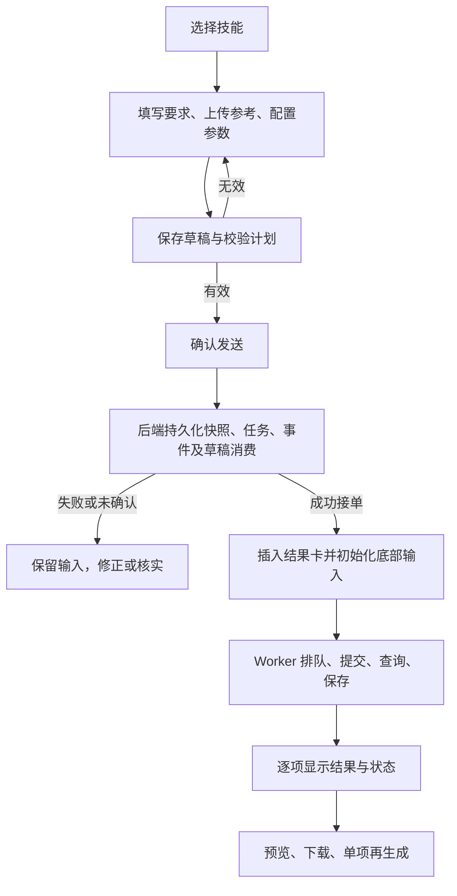
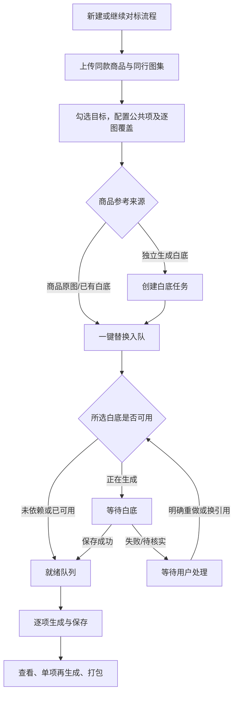

# AI 创作工作台 · 产品需求文档（PRD）

| 文档属性 | 内容 |
| --- | --- |
| 产品名称 | AI 创作工作台 |
| 产品版本 | V1.0 |
| 文档版本 | 1.0 |
| 编写日期 | 2026-10-28 |
| 文档定位 | 供产品、Stitch 原型设计、前后端开发、测试和 Windows 发布共同使用的功能需求基线 |
| 当前阶段 | 已确认方案的集中整理；尚未开发应用、完成接口测试或启动真实生成 |
| 首期平台 | Windows 11 x64 本地后端 + 桌面浏览器网页 |
| 首期用户 | 国内抖音服装运营，先以男装场景验证 |
| 视觉范围 | 本文定义页面职责、信息层级、交互和状态，不规定配色、字体、装饰与视觉风格；后续由 Stitch 设计原型 |

## 目录

1. [产品背景与目标](#1-产品背景与目标)
2. [用户角色与典型场景](#2-用户角色与典型场景)
3. [范围、优先级与固定原则](#3-范围优先级与固定原则)
4. [领域概念与数量口径](#4-领域概念与数量口径)
5. [信息架构与页面清单](#5-信息架构与页面清单)
6. [核心用户流程](#6-核心用户流程)
7. [普通技能工作台](#7-普通技能工作台)
8. [四个普通技能详细需求](#8-四个普通技能详细需求)
9. [一键对标智能体](#9-一键对标智能体)
10. [素材上传与媒体预览](#10-素材上传与媒体预览)
11. [任务结果流、详情与下载](#11-任务结果流详情与下载)
12. [后台任务、调度与恢复](#12-后台任务调度与恢复)
13. [草稿、自动保存与并发编辑](#13-草稿自动保存与并发编辑)
14. [技能管理与扩展](#14-技能管理与扩展)
15. [模型与供应商管理](#15-模型与供应商管理)
16. [算力统计](#16-算力统计)
17. [设置、文件与本地交付](#17-设置文件与本地交付)
18. [前后端职责与数据需求](#18-前后端职责与数据需求)
19. [全局状态与异常处理](#19-全局状态与异常处理)
20. [非功能与体验要求](#20-非功能与体验要求)
21. [验收用例与交付标准](#21-验收用例与交付标准)
22. [开发拆分与待验证事项](#22-开发拆分与待验证事项)
23. [Stitch 原型交付要求](#23-stitch-原型交付要求)
24. [来源与维护规则](#24-来源与维护规则)

## 1. 产品背景与目标

### 1.1 背景

服装运营需要反复制作商品图片、换装图、场景图与短视频。已有系统的项目创建、分析、多阶段跳转和多重版本管理较重，普通生成也被迫进入复杂流程。新系统需要将日常制作收敛为“选择技能 → 输入素材和要求 → 发送 → 后台生成 → 查看和下载”。

普通图片与视频不以聊天为主要展示形式，不要求先建立商品项目，不强制研究商品或先调用文本模型生成提示词。对于批量图片替换，使用独立智能体承载素材整理、白底准备与逐图配置。

### 1.2 产品目标

| 目标编号 | 目标 | 实现要求 |
| --- | --- | --- |
| G-01 | 减少日常操作步骤 | 普通技能一次发送即可启动后台制作，不增加提示词确认或生成结果确认关卡 |
| G-02 | 单项和批量使用同一机制 | 数量变化只改变服务端任务展开，不切换另一套生成系统 |
| G-03 | 任务不依赖浏览器存活 | 关闭网页、刷新、切换技能不影响已提交任务 |
| G-04 | 生成过程清楚可追踪 | 状态、当前步骤、结果和异常来源可查询，未知状态不冒充失败或成功 |
| G-05 | 新增技能和模型可维护 | 技能以 Markdown 发布，模型按能力和协议配置；不在页面写死调用逻辑 |
| G-06 | 数据和消耗可核对 | 保存执行快照、历史尝试、产物与点数流水，异常恢复不重复生成或计点 |
| G-07 | 本地可独立交付 | Windows 发布包通过 run.bat 启动，不依赖旧系统正在运行 |

### 1.3 成功的定义

- **发送成功**：后端已持久化任务、输入快照与必要依赖，能够返回任务编号。
- **生成完成**：该成品已生成、经过基础文件校验并可靠保存；不以供应商返回成功但未保存作为完成。
- **质量合格**：用户人工判断商品细节、人物、场景和文字可用，与技术生成完成分开。
- **批量完成**：原始目标成品均已可靠保存；失败、待保存和待核实分别报告，不能折算成完成。
- **测试通过**：有真实测试记录；本文存在、YAML 可解析或构建成功不代表整个产品通过验收。

## 2. 用户角色与典型场景

### 2.1 用户角色

首版是单机、单操作员工具。同一个人可以同时执行创作和设置，不建设账号、组织、权限分组与审批系统。

| 使用角色 | 核心诉求 | 主要功能 |
| --- | --- | --- |
| 服装运营/创作者 | 快速制作图和短视频、重复用图、批量替换 | 普通技能、一键对标、历史结果、下载 |
| 本机维护者 | 配置 API、模型、技能和内部点数 | 设置、技能发布、模型管理、统计、备份诊断 |

### 2.2 典型场景

1. 输入新品宣传要求，上传商品图，生成 4 张不同构图图片。
2. 上传同款衣服多个角度和 5 张模特图，每张模特图生成 2 个换装版本。
3. 上传新商品和已有场景图，以新商品替换场景中的旧商品。
4. 提供已经写好的视频提示词和参考图，生成一段或多段独立短视频。
5. 批量上传同行商品链接中的图片，勾选需要替换的图，使用自有商品逐张替换。
6. 先生成白底图，同时提交替换任务；白底完成后后台自动继续。
7. 关闭网页后稍晚回来查看结果，下载本批已完成文件。
8. 从某次历史任务“使用本次设置”，修改要求后再次制作。

## 3. 范围、优先级与固定原则

### 3.1 首版范围

| 模块 | 首版包含 |
| --- | --- |
| 图片类 | 图片生成、模特换装、场景复刻 |
| 视频类 | 视频生成 |
| 智能体 | 一键对标（图片流程） |
| 共用能力 | 动态参数、上传预览、独立结果流、后台任务、历史尝试、打包下载、自动保存 |
| 设置 | 技能、模型/供应商、算力、并发、存储、备份/恢复、运行诊断 |

### 3.2 首版排除

不做桌面 EXE 壳、手机适配、开机自启、多人协作、云端账户、自动发布、灵感池/收藏库、抖音链接自动抓取、登录/验证码浏览器、视频解析/爆款视频智能体、文本 AI 提示词反推、自动编导、连续分镜合成、独立 TTS/字幕/背景音乐后期、自动图片分类/视觉质检。

“一键对标上传爆款链接图片”首版指用户从该商品链接准备图片后批量上传；链接字段只记录来源，不承诺粘贴后自动获取。

### 3.3 优先级

- **P0**：基本生成闭环、可靠接单、后台恢复、素材保存、算力幂等、本地启动与数据保护；首版发布阻断项。
- **P1**：历史设置复用、批次公平调度、发布预览、结果查找和批量操作效率；也属于 V1.0，排在共用底座之后开发。
- **后续**：3.2 列出的能力，不在首版显示不可用的制作入口。

### 3.4 固定原则

1. 普通技能一次发送直接开始制作，不默认额外调用文本模型研究、翻译或规划。
2. 普通技能之间的数据独立；后台任务全局可查看，但不混入其他技能的结果流。
3. 智能体复用同一后台协议，使用独立流程页面，不显示通用底部输入区。
4. 发送成功后初始化底部文字、素材和参数；发送失败或受理未知时保留输入。
5. 所有已提交任务后台执行；切换页面不提供隐式暂停、中断或取消。
6. 保存成功计本机点数，失败不计，未确认/待保存单列；算力只提醒、不作为硬预算。
7. 配置变更不静默修改旧任务；失败恢复不重做已成功步骤。
8. 不宣称完美复制服装细节；模型能力和生成质量需分别验证。

## 4. 领域概念与数量口径

| 概念 | 定义 |
| --- | --- |
| 技能 | 可复用的输入角色、参数、提示词和执行规则，不是模型 |
| 智能体 | 将多个动作和依赖组合完成目标的流程；首版为一键对标 |
| 自有商品 | 用户希望宣传或替换进参考画面的商品 |
| 商品参考组 | 同一款/颜色或 SKU 的多个角度；不是多个商品 |
| 目标图/同行图 | 希望沿用其人物、构图或场景、替换指定商品的图片 |
| 创作记录 | 普通一次提交或一次智能体流程的持久化容器，不要求用户管理“项目” |
| 批次 | 一次操作要求完成的一组成品，允许只有一个成品 |
| item | 一项明确的成品目标；对标时一张同行图为一个 item，可包含多个版本 |
| 尝试 | 为某个版本发起的一次生成；再生成是新尝试 |
| 白底任务 | 用户单独启动的辅助商品图生成，可被多个替换 item 引用 |
| 执行快照 | 实际技能修订、变量、素材角色、提示词、模型配置和参数的固定记录 |
| 草稿 | 尚未正式提交的输入；与已锁定的执行快照分开 |
| 算力点 | 内部统计单位，独立于供应商费用、余额和 Token |

数量必须区分以下含义：

| 场景 | 请求展开 | 规则 |
| --- | --- | --- |
| 普通图片 | N 张成品 = N 次单图生成 | 不自动拼成一张联系表；用户明确要求的单张四宫格仍算一张 |
| 普通视频 | N 段成品 = N 次视频生成 | 每段独立，不等于一条 N 镜故事，不自动拼接 |
| 换装/场景复刻 | M 张已选目标 × 每图 V 版 | 同商品多角度只是引用，不乘进成品数 |
| 一键对标 | M 张已选同行图 × 每图 V 版 | 未选不生成、不计点；白底调用另计 |
| 新生成白底 | 独立 1 次图片请求 | 多个 item 引用同一白底不重复调用/计点 |

默认成品数和每图版本数为 1。最大批量、文件限制等由服务端配置并前端展示，不任意猜测、静默截断或自动做商品×场景全组合。

## 5. 信息架构与页面清单

### 5.1 导航

主入口为左侧技能导航：系统名称、全部/图片/视频/智能体分类、技能项、设置。技能项包含名称、一句话介绍和必要状态，不把模型名作为技能名。不设独立灵感池、素材库、强制项目管理或技能管理主导航；技能管理从设置进入。

“全部”显示所有已发布入口；分类仅筛选入口，不合并结果数据。已发布但不兼容当前环境的技能可显示原因并禁用生成；未来功能不以空壳技能提前出现。

### 5.2 页面与弹层清单

| 编号 | 页面/容器 | 核心内容 | 关键出口 |
| --- | --- | --- | --- |
| P-01 | 普通技能工作台（四技能共用） | 技能说明、本技能结果流、后台入口、底部输入区 | 发送、预览、参数矩阵、任务详情 |
| P-02 | 一键对标流程页 | 商品与同行素材、选择与配置、白底任务、三栏 item、批量操作 | 生成白底、一键替换、逐项编辑、下载 |
| P-03 | 全局后台任务抽屉 | 全技能进行中/待处理任务、归属与步骤 | 定位原技能/流程、打开详情 |
| P-04 | 任务详情抽屉/弹窗 | 输入和执行快照、日志、费用、尝试历史、异常处理 | 使用本次设置、失败恢复、查看媒体 |
| P-05 | 设置容器 | 模型/供应商、技能、算力、运行/存储/备份与诊断 | 各配置详情 |
| P-06 | 技能编辑与发布页 | 文件内容、字段、校验、表单与执行稿预览、修订 | 校验、预览、发布、归档 |
| P-07 | 模型/供应商编辑页 | 凭证引用、合同能力、参数、默认/启用、费用依据 | 保存、静态检查、显式生成测试 |
| P-08 | 算力与统计页 | 额度、规则、用量筛选、流水、导出 | 调整额度、发布规则、核对异常 |
| D-01 | 参数矩阵弹窗 | 技能特有字段、模型专有参数、固定约束 | 应用本次参数、关闭 |
| D-02 | 媒体预览弹窗 | 原图/视频播放器、批量前后切换 | 缩放、播放、关闭 |
| D-03 | 提示词预览/编辑弹窗 | 实际执行稿或标明的待执行稿、覆盖编辑 | 复制、保存（允许编辑时） |
| D-04 | 冲突/恢复/删除等确认容器 | 影响范围、原因、保留本地内容、可选处理 | 明确完成对应操作 |

D-04 仅用于确实有数据覆盖/删除/未知提交等分歧，不对正常发送增加重复确认。可复用基础弹窗，设计工具不必为每个变体建立独立路由。

### 5.3 原型信息层级

普通工作台主内容从上至下为：当前技能说明 → 独立任务结果流 → 底部浮动输入区。默认任务卡仅显示执行状态、当前步骤、产物缩略图、打包下载和 item 操作。模型/费用/日志等在详情显示。

智能体主内容为完整流程与逐图配置，不挂载通用底部输入区，不保留相应空白。设置为独立操作区，不挤占日常创作。

## 6. 核心用户流程

### 6.1 普通技能一次发送



计划校验和估算由界面自动完成，不要求普通用户再点一次“生成提示词”。计划失效时更新摘要；实质改变调用范围、模型或数量的变化须明确展示后再发送。

### 6.2 一键对标



上传商品图即可直接替换。白底按钮独立，用户只生成白底时不自动建立替换任务；用户已点一键替换时，依赖成功后自动继续，不增加白底审核关卡。

### 6.3 质量不满意与技术失败

质量不满意 → 用户对指定项明确重新生成 → 新尝试和新增估算 → 原图保留。

明确生成失败 → 只对失败项启动关联重试；下载失败 → 恢复原结果保存；受理未知 → 核实后处理。不得混成一个自动从头执行流程。

## 7. 普通技能工作台

### 7.1 功能清单

| 编号 | 需求 | 优先级 |
| --- | --- | --- |
| WS-01 | 四普通技能共用工作台，不显示聊天气泡 | P0 |
| WS-02 | 每技能独立草稿、素材选择、结果流，切换不影响后台任务 | P0 |
| WS-03 | 底部大输入框、动态上传、模型/常用参数、参数矩阵、确认发送 | P0 |
| WS-04 | 后端接单成功后全量初始化底部输入，失败/未知不丢输入 | P0 |
| WS-05 | 任务卡一致骨架、批量网格、item 提示词与再生成操作 | P0 |
| WS-06 | 任务详情回填历史设置到新草稿，不自动调用 | P1 |
| WS-07 | 结果流分页、状态/日期筛选、按任务编号定位 | P1 |

### 7.2 底部输入区

| 控件 | 要求 | 默认/校验 |
| --- | --- | --- |
| 大输入框 | 本次提示词或补充要求，支持多行；不能当作 AI 聊天气泡 | 图片至少有要求或参考图；视频需要有效提示词；换装/复刻按角色与业务必填校验 |
| 上传按钮 | 根据技能素材角色与模型能力控制图/视频、单张/多张 | 仅允许已验证类型；显示剩余容量，不显示文件名 |
| 素材叠放区 | 已选图/视频封面按便利贴式叠放，带数量、角色和状态 | 默认紧凑，悬浮/点击/键盘展开全部；大批量浮层滚动 |
| 模型选择 | 仅显示本技能兼容模型；不可用项解释原因 | 当前技能的默认可用模型，不默认静默替换失效型号 |
| 常用参数 | 数量、画幅、视频时长等与当前模型关联 | 默认值来自已发布技能和模型定义，不在页面重复写死 |
| 参数矩阵按钮 | 打开技能特有参数和模型专有参数弹窗 | 只改本次草稿，不改全局技能文件 |
| 确认发送 | 显示输出数量和预计点数/点数未知 | 上传未完成、必填缺失、参数不兼容时不可提交并给原因；额度不足不禁用 |

参数控件优先用中文标签；英文 API 键和值保存在高级详情，不要求用户理解英文参数。自由输入的英文提示词原样保存，首版不隐含调用翻译模型。

### 7.3 参数矩阵

- “技能特有参数”与“模型专有参数”分区；字段随当前技能/模型动态变化。
- 显示名称、说明、可选值、默认、必填/条件要求；固定值只读并说明原因。
- 不把任意 JSON 编辑器作为普通用户的默认操作。
- 快捷参数与弹窗共用同一个草稿字段；取消未应用编辑恢复弹窗打开前的值。
- 应用后同步校验素材兼容性、输出数量和预计消耗。
- 仅配置参数不创建任务、不计点；关闭弹窗不重置输入。

### 7.4 成功发送后的初始化

| 内容 | 成功接单后 |
| --- | --- |
| 文字、临时提示词覆盖 | 清空 |
| 参考图片/视频与角色配对 | 清空本次选择，已保存文件和任务引用保留 |
| 数量、画幅、时长、业务字段、模型参数 | 恢复当前技能与默认模型的合法默认值 |
| 当前模型 | 回到该技能默认可用模型；缺失时明确待选择 |
| 临时错误、估算、上传选择状态 | 清除并重新计算 |
| 当前技能、导航、历史结果、后台执行 | 保留 |
| 后端草稿 | 消费本次修订并重置，刷新后不复现旧输入 |

不能在点击发送、上传完成或仅收到客户端请求发出事件时清空。网络断开但后台可能已接单时，使用同一幂等标识查询/重发核实；核实成功再初始化。

发送期间可短暂锁定本次草稿，恢复输入后无需等待成品生成。自动保存的旧响应、其他标签页或延迟事件不得恢复已消费输入，也不能清掉下一条新草稿。

### 7.5 使用本次设置

从任务详情回填某个历史尝试的素材、要求、变量、提示词覆盖和模型参数到该技能的新草稿。已有输入时保留原草稿，并明确处理覆盖；原引用失效、技能升级不兼容或模型失效时指出修正项。回填不自动生成，不重写历史。

## 8. 四个普通技能详细需求

### 8.1 图片生成（IMG-01）

**目标**：输入提示词和可选参考图，一次生成单张或多张独立商品图片。

| 字段 | 类型 | 必填 | 规则 |
| --- | --- | --- | --- |
| 本次要求 | 多行文本 | 条件必填 | 与参考图不能同时为空 |
| 参考图片 | 单组多张 | 否 | 标注用途/角色，最终集合满足模型引用限制 |
| 成品数量 | 正整数 | 是 | 默认 1，最大值由运行配置限制 |
| 多图差异 | 选择 | 是 | 独立构图（默认）/不同角度/不同场景/按补充要求 |
| 模型与参数 | 动态字段 | 是 | 图片模型类别及合法参数 |

业务规则：

1. N 张由服务端展开 N 个单图任务，用户不逐张发送。
2. 共享商品信息、技能风格和用户要求，每张加入明确序号与差异策略。
3. 不依赖文本 AI 额外规划；不将前一张成品作为下一张参考。
4. 每请求只输出一张独立图；单张四宫格仅在用户明确要求时使用，不能把 N 张误作一张拼图。
5. 新商品细节以参考为依据，不虚构背面、面料性能、销量、价格；新宣传文案仅按用户输入。

输出：N 个 item/成品目标、各自尝试与实际执行提示词、状态和媒体结果。单项失败可独立恢复。

### 8.2 模特换装（OUT-01）

**目标**：在一张或多张模特图中，将明确指定服装替换为自有商品，保持人物与可适配场景。

| 字段 | 类型 | 必填 | 规则 |
| --- | --- | --- | --- |
| 自有商品图 | 同款多角度组 | 是 | 至少 1 张，不自动将不同商品混为一组 |
| 模特参考图 | 多目标集合 | 是 | 至少选择 1 张目标；可批量选择并逐图覆盖 |
| 换装范围 | 选择 | 是 | 整件换装（默认）/只换图案或颜色 |
| 替换对象 | 公共描述 + 逐图覆盖 | 是 | 明确人物和部位，支持上衣/裤子/整套等描述；不要求 AI 自动识别 |
| 新宣传文案 | 文本 | 否 | 留空不添加，去掉旧广告文案 |
| 每图版本数 | 正整数 | 是 | 默认 1，总成品 M×V |
| 补充要求/模型参数 | 文本/动态字段 | 按规则 | 当前模型合法且引用容量足够 |

整件换装按新品领口、袖长、衣长、口袋、版型、颜色、Logo、印花和已知材质外观。图案/颜色模式保持原衣服版型，仅改变明确范围。保留非目标人物、姿态、身份和场景关系；不承诺服装与遮挡冲突时像素不变。

原商品可见印字与新宣传文案分开；未提供新品背面不能声称准确重建。多人物、遮挡、缺角等由用户判断/补图，首版没有视觉预检模型。

### 8.3 场景复刻（SCN-01）

**目标**：使用成熟场景/构图，将旧商品替换为新商品，支持平铺、挂拍、静物和上身场景。

输入结构沿用模特换装：一件商品的多角度图、多张场景目标、明确替换对象、新文案、每图版本数、补充要求与模型参数。场景适配方式默认按新商品替换，不能将旧商品的版型/品牌/卖点套给新商品。

| 要素 | 来源与处理 |
| --- | --- |
| 商品款式、颜色、Logo、可见结构 | 自有商品图 |
| 场景、构图、机位、人物姿态 | 当前场景目标图，必要时按物理关系合理适配 |
| 旧宣传文案、价格、促销与广告品牌 | 去掉 |
| 新宣传文案 | 仅用户提供时添加；留空不添 |
| 不可见结构/性能信息 | 不推定为事实 |

单个目标和批量使用同一展开规则 M×V；每批默认一件商品，不建立多商品×场景的笛卡尔积。

### 8.4 视频生成（VID-01）

**目标**：用户已有提示词或脚本描述，配合可选参考图直接生成一段或多段独立视频。

| 字段 | 类型 | 必填 | 规则 |
| --- | --- | --- | --- |
| 视频提示词 | 多行文本 | 是 | 不要求先分析原视频或先生成提示词 |
| 参考图片 | 多张 | 否 | 由当前模型限制数量和角色 |
| 视频数量 | 正整数 | 是 | 默认 1，各段独立 |
| 单段时长、画幅 | 动态枚举/合法范围 | 是 | 依据模型合同，不能任意填写 15 秒等不支持值 |
| 多视频差异 | 选择 | 是 | 独立演绎（默认）/不同运镜/不同动作/按补充要求 |
| 提示词增强/超分等 | 动态字段 | 按模型 | 不支持的控件不显示，不透传其他模型字段 |

首版不合并多段、不分析原片、不制作视频分镜工坊。Omni 的参考图片能力不等于参考视频、首尾帧控制、中文口型或完整配音能力。

参数区提供能力说明：首版没有独立字幕/配音/音乐后期；用户写进自由提示词不代表必定交付。明确配置的结构化需求若缺乏对应能力，应解释并阻止该不兼容计划；系统不承诺自动识别自由文本里的所有后期要求。模型若有已验证原生音轨，按其真实输出交付，详情标明实际文件是否含音轨，不冒称已经制作指定配音与音乐。

## 9. 一键对标智能体

### 9.1 定位与功能编号

| 编号 | 功能 | 优先级 |
| --- | --- | --- |
| AG-01 | 独立流程创建/继续，自动保存，商品和同行图准备 | P0 |
| AG-02 | 勾选目标、公共配置、逐项覆盖与三栏 item | P0 |
| AG-03 | 独立白底生成与已有白底引用 | P0 |
| AG-04 | 替换提前排队并绑定具体白底任务 | P0 |
| AG-05 | 未提交可编辑，已提交修改用于新尝试 | P0 |
| AG-06 | 白底失败等待处理及主动重绑 | P0 |
| AG-07 | 批量应用、单项再生成与逐图打包 | P1 |

### 9.2 流程页面组成

1. 流程名称/编号、当前状态及历史记录入口。用户无需另建商品项目，可新建或继续一条创作记录。
2. 自有商品资料：同款角度图，可填款式/颜色/SKU 标识；不强制商品档案。
3. 同行图集：上传、排序、选择生成目标，来源链接仅记录。
4. 公共配置：替换对象、范围、新文案、每图版本数、图片模型、参数和商品参考来源。
5. 白底区域：独立生成按钮、已有图选择、任务状态及产物预览。
6. 三栏 item 工作区与一键替换/批量应用按钮。
7. 批次进度、结果、打包及待处理入口。

流程中的商品与配对资料在提交后保留供逐图处理，不套用普通底部输入区的清空规则。每条流程独立，切换流程不混合素材和结果。

### 9.3 三栏 item

| 左侧：同行图片 | 中间：本项配置 | 右侧：结果与状态 |
| --- | --- | --- |
| 缩略图、勾选、目标说明、顺序 | 模型、画幅等参数、商品/白底/辅助参考缩略图、提示词编辑入口 | 当前步骤、各版本结果、等待/失败信息 |
| 点击放大原图 | 默认系统提示词隐藏，点击编辑/预览 | 图片点击放大、提示词预览/复制、重新生成 |

默认每图 1 个版本。批量引用、多版本、必要说明可增行；普通单项尽量统一高度。界面不显示文件名，以角色与序号标识。

原商品图始终是款式依据；选择白底时增加辅助引用。当前同行图只绑定本 item，不把整个图集都交给每次生成。可添加额外参考，去重后重新校验容量。

### 9.4 白底的三个模式

| 模式 | 输入与行为 | 增加调用 |
| --- | --- | --- |
| 直接使用商品原图（默认） | 商品组 + 当前同行图 + 明确添加的辅助图 | 无前置白底调用 |
| 使用已有白底 | 有效单张白底 + 商品原图 + 当前同行图 | 无前置白底调用 |
| 使用白底任务结果 | 指定已创建白底任务 ID；未完成可等待 | 仅用户单独创建白底任务时增加其请求 |

“生成白底图”只依据商品参考制作 1 张资料图，明确纯白不透明、去掉人物/道具/广告，保留已知商品细节；`background=opaque` 只是模型约束，不代替提示词的纯白要求。

仅生成白底不会自动替换。替换动作不会暗中创建白底调用。白底已经在运行时，用户仍可提交一键替换；后端立刻持久化 item 及依赖，等待其结果。依赖绑定具体任务/产物修订，不是“最新白底图”。

可准确匹配的白底缓存允许明确复用并标记来源，不产生新消耗；用户明确重做则创建新尝试并绕过缓存。原图直用/已有图模式不伪造白底任务。

### 9.5 一键替换提交

- 至少选择 1 张目标，逐项有合法对象、参考和参数；未选只留资料，不调用、不计点。
- 显示 M 张目标、每图 V 版、总替换数和预计点数；已在运行的白底点数不能再算成一次新调用。
- 一次后端请求建立任务和依赖，前端不循环逐张发送。
- 提交后各就绪项独立运行；未就绪项显示等待白底，不占活动生成槽。
- 不需要等待前一张替换完成，也不将前项生成结果作为后一项参考。
- 完成部分保留，单项失败不重做其他成功项或白底。

### 9.6 排队编辑与批量应用

| 情况 | 允许的操作 |
| --- | --- |
| 草稿、等待白底、排队且尚未提交 | 编辑参数、参考、提示词，显式保存后更新修订与估算 |
| Worker 已领取进入提交临界区 | 保存不能伪装成功；返回冲突并保留本地修改 |
| 已提交/查询/成功/明确失败的尝试 | 不改本次快照；修改可形成新尝试草稿，由用户明确启动 |
| 多个未提交项 | 明确勾选后批量应用，展示影响数量；不能覆盖未选项 |

批量保存若遇到部分 item 已锁定，明确返回已应用、冲突、未修改清单；不静默当作全部成功。每个 item 的保存及领取必须原子校验修订，避免显示新参数却提交旧输入。单项提示词覆盖不修改全局技能。

### 9.7 白底失败与引用替换

依赖白底失败或待核实后，item 保持“等待白底图处理”，提供：重做白底、改用上传图、改用商品原图。用户明确选择受影响的未提交 item，后端校验、保存新绑定并自动继续；不自动降级、换图或全批判失败。

白底受理未知时不能直接盲目重做原请求，需先核实；仍允许用户把未提交依赖主动改为其他有效引用。已提交 item 不参与重绑，其他无关任务继续。

## 10. 素材上传与媒体预览

### 10.1 上传能力（AS-01，P0）

允许类型与单多张规则由“已发布技能输入声明 ∩ 所选模型已验证能力 ∩ 应用文件规则”决定。不从自然语言提示词猜测上传合同。

| 规则 | 要求 |
| --- | --- |
| 输入方式 | 文件选择、拖拽、复制粘贴共用同一套校验 |
| 角色 | 商品、模特/人物、场景、辅助参考等；多角色有明确选择和标识 |
| 单张 | 单选；已有图时替换须明确，不静默增加 |
| 多张 | 显示数量与可用容量，超限给出原因，不自动丢弃或截断 |
| 视频参考 | 只有技能与模型均声明并验证支持时开放；当前默认技能不因“视频生成”自动接受视频 |
| 校验 | 服务端验证实际文件类型、可读取性、大小、媒体基本信息与引用总量；不能只相信扩展名 |
| 上传中的素材 | 显示上传进度/失败状态，不视为可执行素材 |
| 本地保存 | 保存为应用素材 ID，不依赖浏览器临时 URL 或原文件路径 |
| 去重 | 保持业务角色，引用数量按最终真实集合计算；不能因合并 ID 丢失角色说明 |

模型切换导致不兼容时保留待处理选择并提示移除/更换；不静默丢参考图，也不将不支持的引用提交上游。文件限制与供应商编码引用限制区分，最终请求再次由后端校验。

### 10.2 便利贴式叠放（AS-02，P0）

底部输入区默认露出少量叠放缩略图和总数，不显示文件名。鼠标移入展开全部；点击数量入口或键盘聚焦也能展开。缩略图有角色、序号和状态；展开后可预览和移除。

大量素材使用有最大高度的滚动浮层，优先向上展开，不无限增高输入区或盖住发送按钮。从叠放区移动到浮层时不突然关闭。视频只展示封面和播放标识，不在叠放区自动播放。

### 10.3 媒体预览（AS-03，P0）

| 图片 | 视频 | 共用 |
| --- | --- | --- |
| 原图、适应窗口、缩放，默认完整显示商品 | 真实播放器、播放/暂停、进度、音量、全屏；不只放大封面 | 有标题、批量前后切换、关闭/Escape、焦点恢复 |

封面未就绪时显示真实占位状态，不伪造画面。预览失败可重试，不把已成功生成任务改成失败。关闭弹窗暂停播放，不自动播放有声内容。

### 10.4 删除与引用保护（AS-04，P0）

输入区移除只取消本次选择；清理缓存与删除历史是不同操作。被运行任务、白底依赖、历史尝试引用的素材不能直接物理删除。首版不自动清除原图和历史成品；清理展示范围与预计空间，后端校验并执行。账本与尝试事实不随成品删除而抹除。

## 11. 任务结果流、详情与下载

### 11.1 批次卡与高度（RS-01，P0）

普通一次提交对应一张批次卡，默认只显示：执行状态、当前步骤、产物缩略图、打包下载及每个 item 的提示词预览/复制/重新生成。技能名称与说明在页面顶部，长参数、费用和日志不重复铺开。

单行卡各状态使用相同骨架与基础高度；媒体缩略框等高，横竖图不改变卡高，默认保持商品完整。批量产物按固定网格增行；提示词进弹窗而不是撑高卡片。加载占位与结果同尺寸，状态变化原位更新。

当前用户在历史位置时不因新结果强制滚到底部；展示可发现的新结果提示。结果列表使用稳定任务/item ID，SSE 更新不重复插卡。

### 11.2 item 操作（RS-02，P0）

| 操作 | 输入依据 | 后端/界面行为 |
| --- | --- | --- |
| 预览提示词 | 当前尝试的实际执行稿 | 只读弹窗；尚未提交的稿标明“待执行”，不能冒充已经使用 |
| 复制提示词 | 与预览相同的完整文本 | 不复制省略稿、不使用最新模板重新渲染覆盖旧稿；失败可手动选择 |
| 重新生成 | 指定 item/版本的历史快照 | 新建尝试、估算新增点数、绕过旧成品缓存；保留原图与完成度 |

若原模型不可执行，需明确选择兼容模型，显示变化后再启动；不静默换供应商。支持种子时可明确沿用/更换，未验证时不显示种子能力。再生成不保证输出一定有视觉差异。

正在执行或待核实尝试不提供重复提交同一尝试的再生成操作。编辑覆盖稿不执行，用户明确启动后才形成新调用。单项再生成不让整批退回未完成状态。

### 11.3 批次状态与历史尝试（RS-03，P0）

- 显示原始目标“已保存 x/N”，并独立显示失败、待保存、待核实和新增尝试。
- 已完成 4/4 后重做第 2 张，原批次仍 4/4；显示“第 2 张再生成中”，旧图可用。
- 原批次含 1 项失败时显示“部分成功/存在失败”，不能当作完整成功。
- 同 item 选择查看不同历史尝试不触发生成；旧图、提示词、模型和消耗可追溯。
- 无成功结果时下载不可用，说明原因；部分成功可下载已保存集合。

### 11.4 任务详情（RS-04，P0）

详情分区展示：

1. 任务/批次/item/尝试编号、归属技能/流程、创建和完成时间。
2. 输入快照：商品与目标、素材角色、变量与覆盖稿、技能修订。
3. 执行快照：实际提示词、模型配置、参数、输出计划与上游编号。
4. 进度与日志：排队、提交、上游等待、下载、保存耗时，重试记录和脱敏错误。
5. 结果与尝试历史：原成品、新尝试、文件保存状态。
6. 算力：预计、已计、待核实/待保存、未计价和供应商费用。
7. 可执行处理：使用本次设置、失败项恢复、核实操作、打开媒体。

详情加载失败不清空列表原结果。动作按后端状态开放，不能只凭按钮文案推断是否可重试。

### 11.5 打包下载（DL-01，P0）

- 批次打包包含本次选择的已保存产物，明确文件数量和未包含项。
- 批量存在未完成时允许先打包已有结果，但不将任务标为全部完成。
- 后端创建持久化导出任务；浏览器不循环下载媒体后拼 ZIP。
- 相同产物集合/版本复用有效包或在建打包任务；新增结果或选择其他尝试形成新集合。
- ZIP 按稳定 item、版本/尝试编号命名；有同名文件不互相覆盖。
- 单个媒体可从预览/详情下载，打包仍为卡片主下载入口。
- 打包失败只恢复导出，不生成媒体、不重复计模型点数。
- 关闭网页不停止打包；完成后重新打开可下载，缓存包失效可重建。

## 12. 后台任务、调度与恢复

### 12.1 后台职责（TK-01，P0）

前端只提交用户操作、保存草稿并展示；后端负责计划展开、持久化、供应商提交/查询、媒体下载/校验/保存、封面处理、打包与恢复。不会把后台执行委托给页面计时器。

每次提交固化：技能 ID/修订、变量、素材与角色顺序、模型/配置修订、提示词、参数、算力规则、数量计划、父子关系、依赖、幂等标识。密钥只保存受保护引用，不进快照明文。

### 12.2 状态模型（TK-02，P0）

界面中文状态与后端状态一一映射；实际代码枚举可在共享契约中命名，不由各页面自由创造。

| 状态 | 含义 | 可用处理 |
| --- | --- | --- |
| 等待素材/白底图 | 已接单，明确依赖尚未完成 | 查看依赖、未提交时编辑 |
| 等待白底图处理 | 白底明确失败或待核实，需用户选择 | 重做（受理明确时）、上传/改用原图、核实 |
| 排队 | 依赖满足，等待可用生成槽 | 未提交项可保存修改 |
| 提交中 | 已原子领取并固定输入，正在发送上游 | 查看；锁定本尝试输入 |
| 生成中/查询中 | 有明确上游任务，Worker 持续查询 | 查看日志，不重复提交 |
| 保存中 | 已有结果，正在下载/校验/落盘 | 查看保存状态 |
| 待保存 | 上游成功，但本地下载/保存未完成 | 恢复原结果，不重新生成 |
| 成功 | 有可靠保存的原始产物并完成事务 | 预览、复制提示词、下载、新尝试 |
| 失败 | 有明确失败依据，未成功交付 | 查看原因、单项明确重试 |
| 待核实 | 可能已经受理但无法确定 | 补上游 ID、导入匹配产物、核实未受理后解锁 |

“刷新中”“离线”“预览加载失败”属于视图/连接状态，不修改任务事实。“保存中”如用于草稿，必须在输入区标明为“草稿保存中”，避免与结果保存混淆。

主要转移：排队 → 提交中 → 生成/查询 → 保存中 → 成功；提交结果未知 → 待核实；保存问题 → 待保存；明确生成失败 → 失败。失败后的新付费提交保留关联新尝试，成功结果不回退为失败。

### 12.3 并发与公平调度（TK-03，P1）

1. 图片全局默认 20 活动生成，可在设置修改；白底与所有图片技能共享，不是每批 20。
2. 实际派发同时满足全局、供应商和模型已知限制；显示限制来源，不静默串行化。
3. 视频独立配置。视频默认上限属于发布前配置项，不凭图片 20 推定视频也为 20。
4. 就绪批次间轮流派发，每轮每批一项；批内按创建顺序，单批可用满空闲槽。
5. 上游正在运行的项在轮询间隙仍占活动生成数；等待依赖不占槽。
6. 待核实隔离不堵正常调度，但列出上游实际活动数不确定的风险，原项不自动重发。
7. 下调不取消在途项，等活动数下降后遵守新限额；上调可调度更多就绪项。
8. 上传、查询、下载、缩略图和打包有各自有界资源池；生成满槽不能饿死查询和保存。
9. 429/临时故障按合同退避；受理未知不能当作确定未受理。

首版不提供任务暂停/取消控件。停止整个本地后台属于设置/stop.bat 的运维操作，不等于供应商已停止生成。

### 12.4 幂等与恢复（TK-04，P0）

- 同一次操作双击/网络重发使用同一幂等标识，返回同任务；同标识不同请求内容必须报告冲突。
- Worker 领取有归属、租约与修订检查，不能多个实例同时提交同项。
- 重启先核对遗留执行状态；已受理有上游 ID 的继续查询；提交不明先待核实。
- 供应商已成功但下载失败只恢复原下载，过期链接先重新查询，不能盲目再次生成。
- 结果临时落盘、校验、原子替换后再事务关联；崩溃遗留文件按 ID/哈希核对，避免孤儿和重复导入。
- 同一事务保存结果引用、适用内容、任务状态、点数流水和事件；重复回调/查询只应用一次。
- 运行期间有新编辑，旧结果仍保存；仅输入修订仍匹配的内容可自动应用，冲突不覆盖最新编辑。
- 睡眠/关机期间本地执行暂停；恢复后查询上游，不假设上游也停止。

### 12.5 待核实的人工处理（TK-05，P0）

| 操作 | 条件与结果 |
| --- | --- |
| 补充上游编号 | 校验供应商/模型和任务归属；查询并恢复同一尝试 |
| 导入已生成文件 | 验证匹配关系和文件，记录人工依据；用于完成原尝试，不作为新生成 |
| 确认未受理 | 记录核实依据，解锁用户明确重试；超时本身不是依据 |

操作记录处理时间、方式和依据。未完成核实可长期保留，不阻塞其他就绪任务；不能用“标记失败”绕过重复扣费风险。

## 13. 草稿、自动保存与并发编辑

### 13.1 保存范围（SV-01，P0）

普通技能按技能保存草稿；智能体按创作记录保存商品、同行图、选择、配置、item 修订与依赖。内存状态不作为唯一来源。

输入停止约 800ms 后自动保存，显示保存中/已保存/保存失败。只有后端确认才显示已保存；上传文件保存状态与草稿引用保存状态分开。发送、切换需要依赖该输入的操作前等待保存。

普通已发送记录和智能体有各自持久历史；用户无需管理每个模块的修订号，不新增复杂“项目版本”导航。内部修订用于冲突与追溯。

### 13.2 冲突处理（SV-02，P0）

- 写入带预期修订，版本冲突返回明确错误和最新后端修订，不采用最后写入静默覆盖。
- 本地内容保留，可查看后端内容并明确重新应用；不因冲突丢失文本或参考选择。
- 智能体排队编辑和 Worker 提交领取竞争时只允许准确的一版生效；临界区锁定后修改用于新尝试。
- 已消费草稿的延迟自动保存不能写回；若用户开始下一条输入，旧提交成功事件不能清掉新输入。
- 多标签页共享同一后端任务状态，但各页不能用旧快照覆盖新修订。

### 13.3 历史设置与修订

历史任务按其快照读取。技能更新后旧结果、提示词、模型和媒体仍可查看；新的发送需显式采用当前可执行配置，不静默把旧执行器升级后重跑。查看历史、尝试切换和恢复到新草稿不会自动生成。

## 14. 技能管理与扩展

### 14.1 技能列表与文件（SK-01，P0）

技能管理位于设置，首版预置以下五份应用技能文件：

```text
skills/image-generate/技能提示词.md
skills/model-outfit/技能提示词.md
skills/scene-recreate/技能提示词.md
skills/video-generate/技能提示词.md
skills/benchmark-agent/技能提示词.md
```

文件上部为声明配置，下部按固定标题组织提示词。它是本应用的技能协议，不是可执行任意代码的插件。文件存在不代表已发布或执行器可用。

列表展示名称、分类、一句话说明、执行器、当前修订、已发布/未发布修改/校验失败/归档和默认模型。支持新增、编辑、预览、发布、归档；被历史引用时归档代替物理删除。

### 14.2 字段定义

| 字段组 | 必要内容 |
| --- | --- |
| 基本信息 | 稳定 ID、中文名称、分类 image/video/agent、一句话说明 |
| 执行器 | media 或已注册 workflow；未知执行器不可发布 |
| 素材输入 | 角色、中文标签、类型、单张/组/多目标、必填、条件要求 |
| 技能参数 | 字段键、标签、说明、类型、默认值、枚举/范围、条件规则 |
| 批量展开 | repeat/per-target、数量/版本字段、默认数量、目标选择与覆盖白名单 |
| 模型要求 | 图片/视频类别、默认模型、所需能力；不把 agent 当成供应商模型类别 |
| 固定参数 | 字段、值、作用步骤和锁定理由 |
| 动作与依赖 | 明确按钮操作、步骤关系、内部/外部产物引用与绑定规则 |
| 提示词 | 指定分区、可用占位变量、角色说明和单项执行规则 |

### 14.3 校验、预览与发布（SK-02，P1）

编辑 → 校验 → 预览 → 发布。预览包含用户表单、素材合同、单/多项输出计划、最终提示词示例、模型兼容性、锁定参数和预计点数，不调用文本 AI。

阻止发布：重复 ID、未知字段/变量、缺失提示词分区、未注册执行器、依赖成环、无效模型类别、参数冲突或无效绑定。错误定位文件、分区/字段。发布失败保留上个可用修订。

发布保存完整内容、配置、哈希与修订。直接编辑文件产生未发布修改提示，不自动替换运行时。文件与数据库快照有明确编辑/发布职责，不双向静默覆盖。

### 14.4 扩展边界（SK-03，P0）

使用已注册字段、执行器、媒体与依赖组合的新技能，发布后自动进入对应分类并使用通用界面。新增分析、转写、合成等全新处理器需要后端开发，不能只粘贴自然语言就假装可执行。

模板只允许白名单变量替换，用户内容不递归执行。禁止 eval、Shell/Python/JavaScript 执行、任意文件包含。普通生成不默认增加文本模型步骤。

## 15. 模型与供应商管理

### 15.1 设置功能（MD-01，P0）

| 配置组 | 内容 |
| --- | --- |
| 供应商 | 名称、API 基址、协议/适配器、受保护凭证引用、启用与连接状态 |
| 模型 | 显示名称、供应商、真实上游 ID、image/video 类别、默认/启用 |
| 能力 | 输入类型、参考数量、画幅、时长、分辨率、异步查询、音轨、首尾帧等验证状态 |
| 参数 | 中文名/说明、API 键、类型、枚举与中文映射、默认、范围、条件、常用/高级 |
| 消耗依据 | 供应商费用说明/估算依据；内部点数规则在算力设置维护 |
| 限制 | 并发/限流、编码引用容量、单/多引用映射等合同信息 |

新增图片/视频模型不修改页面常量。相同已支持协议可配置接入，全新协议需要新适配器。保存配置不能自动触发真实生成测试。

静态检查不消耗媒体生成额度；需要真实生成测试时单独显示模型、数量、预计消耗并由用户明确启动。若供应商支持模型发现，可后续同步名称列表，但不能凭名称猜能力。

### 15.2 首版模型基线

以下为现有参考项目代码预设，用于新系统配置与原型字段设计，**不是本 PRD 对供应商最新合同的再次实测**。上线前按实际适配合同验证；变更通过模型定义发布，不硬编码在 UI。

#### TT Image 2.5

| 项目 | 预设 |
| --- | --- |
| 本地/上游 ID | tt-image / tt-image-2.5 |
| 类型 | 图片 |
| 参考图片 | 0–16 张，技能可要求更高的最小值 |
| 画幅 | 9:16、16:9、1:1、4:3、3:4、2:3、3:2 |
| 分辨率 | auto、1K（默认）、2K、4K |
| 版本 | flare（默认）、sunburst |
| 质量 | auto（默认）、low、medium、high、xhigh、max |
| 背景 | opaque（默认）、transparent、auto |

不透明不等于纯白；透明背景要求需验证实际 Alpha，不能凭选项或扩展名认定满足。未取得依据，不展示档位费用倍数或速度承诺。

#### Omni Flash

| 项目 | 预设 |
| --- | --- |
| 本地/上游 ID | omni / omni-flash |
| 类型 | 视频 |
| 参考图片 | 0–3 张；不自动开放参考视频 |
| 画幅 | 9:16、16:9 |
| 单段时长 | 4、6、8、10 秒 |
| 提示词增强 | enhance_prompt：默认关 |
| 超分 | enable_upsample：默认关 |
| 原生音频 | 参考代码有能力标志，实际输出/控制需验证，不作为任意可传开关 |

不为 Omni 添加 TT 分辨率选项；未验证的首尾帧、参考视频、中文口型同步不可显示为可用能力。

### 15.3 兼容性与配置变化（MD-02，P0）

- 有效引用能力取技能、模型声明、适配器实际合同的交集；单引用协议不能静默取 refs[0] 丢掉其他图。
- 每一步最终引用集合校验数量和编码容量；参考适配器现有 30MB 编码引用总量规则须独立验证，不能混同单文件上传上限。
- 固定参数必须存在且值合法，不支持时说明不兼容，不能强行透传。
- 合并顺序：模型默认 → 技能默认 → 本次合法选择；固定约束冲突须解决，不能静默改值。
- false、0、未填写和显式空值按 Schema 分开处理。
- 切换模型保留可处理草稿，只迁移合法交集；不支持值不进入请求，并向用户说明。
- 模型禁用、价格或默认更新不改旧快照；已受理任务继续用其上游 ID 查询。
- 旧任务再生成遇到失效合同，明确选兼容型号，不自动切换供应商或更贵模型。

## 16. 算力统计

### 16.1 功能范围（CR-01，P0）

后台设置统一算力参考额度与模型点数规则，统计按模型、技能、日期、任务展开。仅统计与余额提醒，不做充值、支付、预占、冻结、硬预算或商业账本。

参考额度未设、余额为负、点数规则缺失都不因内部统计禁用生成。供应商真实余额不足或拒绝仍按上游错误处理。

### 16.2 规则与字段（CR-02，P0）

| 项目 | 规则 |
| --- | --- |
| 额度 | 初始值与后续调整记录，调整带原因，不覆盖历史 |
| 点数 | 按次/按视频生成秒；可按参数配置唯一匹配覆盖规则 |
| 时长口径 | 实际合法提交时长，不是裁剪后时长 |
| 取整 | 每个尝试按规则计算后向上取整为整数点 |
| 未配置 | 点数未知，保留次数/时长事实；不能当作 0 |
| 显式 0 点 | 可设置，须与未配置区分 |
| 修订 | 尝试锁定当时规则；新规则不重写旧消耗 |
| 后补规则 | 明确补算产生关联调整流水，不静默改历史 |
| 供应商费用 | 独立金额/币种/估算与实际标记，不能混入点数 |

### 16.3 消耗时点（CR-03，P0）

| 情况 | 本机点数 |
| --- | --- |
| 原始产物可靠保存并提交完成事务 | 按尝试锁定规则计一次 |
| 明确生成失败 | 不计本机点数，不等于供应商退款 |
| 上游成功但本地待保存 | 单列待保存估算，保存成功后计一次 |
| 受理未知 | 单列待核实，不计成已确认消耗 |
| 质量不满意但已保存 | 已完成并计点；再次生成是新增尝试 |
| 同一白底被多项引用 | 原白底成功尝试只计一次 |
| 使用已有媒体/缓存、查询、下载、打包 | 无新的媒体生成点数 |

```text
参考额度 = 初始设置 + 后续调整净额
参考余额 = 参考额度 - 已确认净消耗
```

预计、进行中、待核实/待保存和未计价数量单列，不作为冻结或重复扣入已计合计。父批次/智能体仅聚合子尝试，不能再次增加流水。

示例仅为内部规则演算：每次图片 10 点，5 张目标×2 版=10 次，全部保存后 100 点；另明确新生成白底一次，保存后增加 10 点，整体 110 点。白底被 10 个子项引用仍只增加这一次。

### 16.4 统计页面（CR-04，P1）

筛选模型、技能、日期与任务，显示次数、成功/失败/未知、视频生成时长、已计点数、未计价数、供应商费用及明细。统计与 CSV 导出同口径；UTC 存储时间，默认 Asia/Shanghai 查询，点数按成功保存事务完成时间归属日期。

首页显示参考余额/消耗摘要；发送按钮旁显示预计；默认紧凑卡不展开费用表，详情可核对。冲正/补算保留原记录与依据，不能删除消费事实。

## 17. 设置、文件与本地交付

### 17.1 设置模块（ST-01，P0）

| 分区 | 内容 |
| --- | --- |
| 模型与供应商 | 凭证、模型、能力、参数、默认/启用、连接/测试 |
| 技能 | 五技能文件、编辑、校验、预览、发布、修订/归档 |
| 算力与统计 | 参考额度、点数规则、筛选、流水、导出 |
| 任务与运行 | 图片/视频及处理资源限制、队列状态、Worker 健康 |
| 存储与备份 | 数据位置、空间、缓存、依赖保护、备份/恢复 |
| 诊断与版本 | 程序/迁移版本、工具状态、脱敏日志与诊断导出 |

首次未配置时展示检查清单：后端/Worker、数据目录可写、必要模型和媒体凭证、已发布技能。内部算力规则与额度只是提醒，不作为首次使用门禁。设置入口可从错误直接定位相关项。

### 17.2 Windows 启动（LC-01，P0）

- run.bat 启动本地 API/Worker，健康后打开浏览器；不在发布启动时 npm install 或临时编译。
- 发布包内置匹配的 Node 24、运行依赖与需要的 FFmpeg/ffprobe；首版不装 Python 视频解析/Whisper。
- 兼容中文与空格路径；程序与 data 分离，字体/图标等关键资源本地提供，不依赖海外 CDN。
- 重复启动识别已有健康实例，打开现有页面，不产生多个 Worker；端口被其他软件占用给提示，不杀其他进程。
- 默认仅本机 127.0.0.1 访问，首版不开放局域网。
- 关闭浏览器不停止服务；stop.bat 停止本应用，已受理任务保留，重启后核对上游。
- 休眠/关机停止本机执行，不能承诺电脑关闭后本地 Worker 仍运行。
- 支持 Windows 11 x64；其他系统/架构未经测试不得宣称支持。开发机 macOS 成功不代替真实 Windows 验收。

### 17.3 存储与磁盘（ST-02，P0）

数据库保存索引与关系，原始媒体存本地数据目录。新付费提交前检查可写与剩余空间；软预警提醒，明确不可写/低于安全底线时暂停新的付费提交，已有受理结果尽力保存。这是保存条件，不是算力门禁。

空间恢复后继续原结果；磁盘满不导致重新调用模型。缩略图/封面失败独立恢复，不要求重生成原媒体。清理先显示范围，保护在用文件、任务引用与历史；不递归打包备份自身。

### 17.4 完整备份与恢复（ST-03，P0）

备份覆盖数据库、引用素材与成品、技能文件及发布快照、模型/算力配置、版本与媒体校验清单；可重建缓存/日志可排除并说明。

备份使用维护窗口：停止领取新付费提交和写操作，等待上传/落盘/事务到稳定检查点，再封存数据库与文件清单。上游在途可继续，保留任务 ID 后恢复查询；状态不明不伪装已停止。备份不完整必须报告失败，不能写“成功”。

恢复先在独立目录验证，Worker 暂不提交；确认原实例不再同时使用后核对上游。旧备份里显示排队的项，可能在备份之后已被原实例提交，不能直接重放。缺失媒体、点数不一致和不确定尝试须明确处理。

升级前备份，迁移有版本并可重复执行；旧程序不直接打开不兼容新数据库。回退使用配套备份。跨机器的系统保护密钥可能不可移植，恢复后重新配置凭证，不在备份放明文密钥。

## 18. 前后端职责与数据需求

### 18.1 技术边界

| 层 | 约束 |
| --- | --- |
| 前端 | React + TypeScript + Vite + shadcn/ui + Tailwind CSS；管理交互与服务端状态展示，不调用供应商 |
| 后端 | Fastify + TypeScript；校验、草稿、任务命令、配置、查询和本地媒体访问 |
| Worker | 持久化执行、依赖调度、上游提交/查询、下载、媒体处理和导出；可由同一启动器监管 |
| 存储 | SQLite（本地 WAL）与文件存储，无 Redis/云数据库前置依赖 |
| 共用契约 | 字段/状态/错误 Schema 由前后端共享，服务端最终校验 |
| 原系统复用 | 评估复用媒体适配协议和可靠逻辑，新应用独立配置、数据库和媒体，不依赖旧进程 |

### 18.2 核心数据实体

| 实体 | 必须保留的数据 |
| --- | --- |
| SkillRevision | 技能稳定 ID、配置/正文、哈希、发布修订、状态 |
| ModelRevision / Provider | 真实模型 ID、协议/能力/参数/限制修订、凭证引用 |
| Asset | ID、来源、原始元数据、角色、存储路径、哈希、类型/尺寸/时长、引用关系；文件名可存但不在素材 UI 展示 |
| Draft | 所属技能/流程、内容、角色选择、修订、保存时间、消费状态 |
| Creation / Batch | 归属技能/流程、目标数、计划、父子任务、创建与状态 |
| Item / Version | 当前目标 ID、输入覆盖、修订、指定版本和当前/历史尝试引用 |
| Attempt | 幂等标识、实际快照、上游 ID、状态、错误、时间、恢复检查点 |
| Dependency | 指定前置任务/产物修订、满足状态、重绑记录 |
| Artifact | 原始媒体/结构化快照引用、来源尝试、保存/校验状态 |
| Event | 单调游标、实体与修订、状态变化，支持 SSE 补取 |
| CreditRule / Usage / Ledger | 规则修订、次数/秒、点数、未知标记、供应商费用与调整依据 |
| Export / Backup | 产物集合/检查点、文件位置、范围、状态、校验清单 |

内部修订是并发依据，不作为用户要手动管理的多个“方案版本”。历史尝试可查看，生成媒体不迁移到旧系统。首版不迁入旧系统项目与历史数据。

### 18.3 API 能力清单

下表是职责契约，不锁定最终 URL；开发需提供共享请求/响应 Schema 和错误码，原型不显示这些技术字段。

| 能力 | 请求关键项 | 响应与保证 |
| --- | --- | --- |
| 能力/技能列表 | 分类、发布状态 | 参数定义、默认模型、兼容/不可用原因 |
| 草稿读写 | scope、预期修订、内容 | 最新修订/保存成功；冲突保留本地 |
| 素材上传/读取 | 文件、角色、归属 | 已保存素材 ID、元数据、预览；类型/大小错误 |
| 计划预览 | 技能/修订、输入、模型、字段、数量 | 调用展开、依赖、有效参数、预计点数、计划哈希 |
| 正式提交 | 计划/输入修订、幂等标识 | 快速返回已持久化批次/任务/草稿消费结果 |
| item 编辑/重绑 | 预期修订、选中项、改动 | 成功/冲突清单和影响范围，锁定输入不变 |
| 再生成/失败恢复 | item/尝试、动作、幂等标识 | 新尝试或原保存恢复；不重跑无关步骤 |
| 待核实处理 | 上游 ID/文件/核实依据 | 原尝试更新与审计，不自动新付费提交 |
| 快照/事件 | scope、事件游标 | 同一检查点快照和游标，断线补取 |
| 结果列表/详情 | 技能、日期/状态、分页游标 | 稳定结果、历史尝试、快照与日志 |
| 导出打包 | 明确产物集合、幂等标识 | 持久导出任务，完成后下载 |
| 配置/统计/备份 | 各自修订、范围和动作 | 校验、历史、统计和恢复状态 |
| 健康/诊断 | 本机受保护会话 | API、Worker、工具、存储和版本状态 |

长操作快速接单并后台执行；普通文件上传、媒体读取、结果下载和短连接检查保留 HTTP。SSE 异常轻量查询补齐，不高频拉取整个项目。

## 19. 全局状态与异常处理

### 19.1 视图状态（UX-01，P0）

| 状态 | 页面行为 | 不允许的行为 |
| --- | --- | --- |
| 初次加载 | 对应区域占位，有加载说明 | 空白无反馈或全页不可判断 |
| 刷新中 | 保留旧结果并标明更新中 | 每次轮询把卡片清空再出现 |
| 暂无任务 | 当前技能说明与可用输入区；智能体提示准备资料 | 展示虚假示例成品为用户结果 |
| 空筛选结果 | 提示当前条件无结果，可清除筛选 | 当作整个技能从未使用 |
| 上传中/失败 | 对应缩略项显示状态和恢复入口 | 将上传失败图作为有效输入 |
| 保存中/已保存/失败 | 输入编辑区显示后端认可状态 | 请求未成功却显示已保存 |
| 局部接口失败 | 保留可用数据，仅区域报错并重试 | 隐藏已生成文件或重置输入 |
| SSE 断开 | 提示连接恢复，轻量查询；后台照常 | 把所有任务改为失败或停止 |
| 后端不可用 | 保留已显示内容，提示检查本地服务 | 保证此时仍在本机执行 |
| 供应商暂不可用 | 提示对应模型/任务原因，不影响其他功能 | 自动切换模型和付费 |
| 操作成功 | 局部及时反馈；状态由后端事件/响应同步 | 为每项成功弹阻塞确认框 |

### 19.2 异常与处理矩阵（UX-02，P0）

| 异常 | 用户看到什么 | 系统处理 |
| --- | --- | --- |
| 必填/数量/参数错误 | 定位字段，说明原因 | 不创建付费提交，保留输入 |
| 素材超过最终引用上限 | 实际引用数/上限及角色 | 不静默截断，要求明确移除/换模型 |
| 多标签保存冲突 | 本地与后端修订冲突提示 | 保留本地稿，不覆盖 |
| 发送响应丢失 | 正在核实是否接单 | 相同幂等标识核实，不重复建任务 |
| 上游无任务 ID 且受理不明 | 待核实与可用处理 | 隔离并保留请求事实，不自动重发 |
| 明确生成失败 | 失败项、简短原因、详情 | 只允许该项关联新重试 |
| 结果下载/保存失败 | 待保存/磁盘处理提示 | 恢复原结果，不调用生成 |
| 白底失败 | 等待白底图处理 | 主动重绑或明确重做后继续 |
| 技能有未发布修改 | 设置中标记未发布 | 继续用已发布修订，旧任务不变 |
| 模型能力缺失/已禁用 | 不兼容原因 | 提交前拦截真实能力问题，历史可看 |
| 算力不足/未配置 | 非阻断提醒、未知标记 | 生成可用，不冻结 |
| 媒体预览失败 | 预览错误与重试 | 不改生成任务事实 |
| 打包失败 | 导出任务失败 | 恢复导出，不重生成 |
| 备份缺失媒体或恢复失败 | 范围、失败原因、未完成状态 | 不覆盖原数据，不启动自动付费重放 |
| 端口/文件权限/运行依赖错误 | 可理解原因与诊断位置 | 不杀其他进程，不假装后台健康 |

### 19.3 状态同步（UX-03，P0）

- 首次快照与事件游标对应同一检查点；断线补取按持久事件编号。
- 补取范围已过期/游标无效时重新获取一致快照，不无限依赖旧事件。
- 状态刷新串行化，旧请求不能覆盖新修订；相同事件去重，不重复增加成品卡。
- 切换技能先切数据作用域，旧作用域响应不能写入新结果流。
- 前台显示“已保存”前必须获得后端确认，任务完成度基于保存事实。

## 20. 非功能与体验要求

### 20.1 桌面交互与可访问性（NF-01，P0）

- 以桌面使用为准，验收 1280、1440、1920 宽度及常见 Windows 缩放；不做手机适配。
- 普通结果卡信息精简且高度尽量一致，批量允许按行扩展；底部输入不盖住最后一张卡。
- 输入支持中文多行；重要控件/提示中文，API 原枚举可在详情查看。
- 文件名不在上传区或结果缩略项展示，必要技术元数据仅详情；角色/序号可识别。
- 上传、参数、缩略图、播放和任务操作可键盘触达；弹窗有标题、焦点管理、关闭后恢复。
- 状态用文字加标识，不仅靠颜色；允许减少动效。视觉风格后续另定，不影响这些行为。
- 付费动作由明确发送/再生成/白底按钮触发，不在悬浮、预览、筛选、模型切换或设置保存时触发。

### 20.2 性能与资源（NF-02，P1）

- 任务创建不等待上游媒体完成，后台批量编排；记录接单耗时而不是用生成时长衡量接单速度。
- 列表游标分页，缩略图按需加载；大列表必要时虚拟化，不将大量原图或视频同时载入内存。
- 结果查询/下载优先于低优先级缩略/导出工作；采用有界并发与流式文件处理。
- 实测记录本机配置、文件规模、任务数量和供应商，区分上传、排队、上游、下载、落盘时间。
- 不预填“固定几秒出图/视频”等受供应商影响的承诺；接单/列表性能预算在实现时以同一测试机与固定数据集落表验证。

### 20.3 安全与本地边界（NF-03，P0）

API 密钥后端保存，Windows 使用适当系统保护机制；前端和历史快照不含明文密钥。API 校验本机 Host/Origin 与受保护会话，避免其他网页触发本机写操作；不默认开放公网/局域网。

媒体访问使用素材 ID 和受控目录，不将任意文件路径暴露为读写接口。上传与供应商下载按实际类型/大小和受控网络/文件规则处理。技能不执行任意代码。诊断脱敏密钥、鉴权头和带凭证链接；备份不包含明文密钥。

首版不建设云同步/遥测平台；运营统计来自本机任务记录。用户素材会按所选生成任务发往指定供应商，配置中说明本地存储与联网生成边界。

### 20.4 数据可靠性（NF-04，P0）

数据库和文件均有恢复检查点；双写间隙通过稳定 ID、哈希和核对恢复。账本、结果与事件幂等，备份可校验且实测恢复。更新程序不清空 data，不自动迁入旧系统记录。

## 21. 验收用例与交付标准

### 21.1 功能与故障验收矩阵

| 用例 | 关联需求 | 操作/条件 | 预期 |
| --- | --- | --- | --- |
| AC-01 | WS-01/02 | 在图片生成与视频生成之间切换 | 各自草稿/结果独立，已提交任务继续 |
| AC-02 | WS-03/04、SV-01 | 输入文字、图与非默认参数，成功发送 | 后台有快照与任务，底部全部初始化，刷新不恢复已消费输入 |
| AC-03 | WS-04、TK-04 | 发送后响应丢失，使用同幂等标识重试 | 返回同一任务，核实前不丢输入、不重复生成 |
| AC-04 | SV-02 | 下一条输入已开始，上一条自动保存响应晚到 | 新输入不被覆盖，旧草稿不复活 |
| AC-05 | IMG-01 | 一次生成 4 张图 | 服务端创建 4 次单图任务，不产生单张四宫格替代数量 |
| AC-06 | OUT-01 | 同款 3 角度、5 张已选模特、每图 2 版 | 10 次生成，3 角度不乘入成品数，各目标引用正确 |
| AC-07 | OUT-01 | 分别用整件/图案模式且指定左侧人物 | 请求稿明确范围，非目标不被指令替换；质量人工评估 |
| AC-08 | SCN-01 | 换商品场景，新文案留空 | 执行稿去旧广告、不添新广告，商品与场景角色分明 |
| AC-09 | VID-01 | 已有提示词、2 段、合法时长 | 两个独立视频任务，无视频分析或自动合成 |
| AC-10 | MD-02、AS-01 | Omni 选择参考视频或不合法时长 | 未验证输入不可提交，不显示虚假支持 |
| AC-11 | AG-01/02 | 新建对标并批量上传，未勾选部分图 | 未选不进入任务与估算；关闭再开流程恢复 |
| AC-12 | AG-03 | 商品原图直用/已有白底两种模式 | 均无新增白底调用 |
| AC-13 | AG-03 | 仅点击生成白底 | 只产生白底任务，不自动替换整批 |
| AC-14 | AG-04 | 白底运行时点一键替换，关闭所有页面 | item 已持久化等待；白底保存后后台自动继续，无审核关卡 |
| AC-15 | AG-04 | 等待期间另生成一张白底 | 原依赖仍指向指定任务，不偷偷换成最新图 |
| AC-16 | AG-05、SV-02 | 排队保存与 Worker 领取同时发生 | 明确唯一生效修订；冲突保留本地编辑 |
| AC-17 | AG-06 | 白底失败，选部分未提交项改用原图 | 只恢复相应项；无自动降级、无已提交输入变化 |
| AC-18 | AG-07 | 批量应用时一项已提交 | 返回应用/冲突清单，不伪装全成功 |
| AC-19 | AS-01/02 | 选择、粘贴、拖拽同一组超限素材 | 同规则校验，不显示文件名、不静默截断；叠放可展开全部 |
| AC-20 | AS-03 | 点击图片/视频缩略图并关闭 | 图片可放大，视频可播放，关闭暂停并恢复焦点 |
| AC-21 | RS-01、UX-01 | 各状态单产物/横竖图片/视频卡 | 单行骨架尽量等高，批量网格增行，日志不撑卡 |
| AC-22 | RS-02 | 预览/复制某次历史执行稿 | 文本一致且完整，不被新版模板替换 |
| AC-23 | RS-02/03 | 4/4 完成后再生成第 2 张 | 新尝试绕过旧缓存，原 4/4 与旧图保留，只显示新尝试进度 |
| AC-24 | WS-06 | 使用历史设置，当前已有草稿 | 原草稿保护，明确回填；没有自动生成和计点 |
| AC-25 | DL-01 | 部分成功时打包并关网页 | 仅打包说明的已保存结果，后台继续，失败只恢复导出 |
| AC-26 | TK-03 | 25 个就绪图片，测试合同允许 20 | 活动不超过有效上限，其余排队；轮询间隙不释放在途槽 |
| AC-27 | TK-03 | A 大批次，B 后来单图 | 后续空闲槽按批次轮转，B 不等 A 全部排队项结束 |
| AC-28 | TK-03 | 图片上限从 20 下调再上调 | 不取消在途任务，后续派发符合新限制 |
| AC-29 | TK-04 | 有上游 ID 时重启 API/Worker | 恢复查询原任务，不重复提交 |
| AC-30 | TK-04/05 | 请求可能受理但响应丢失 | 待核实隔离，不自动重发，不堵其他就绪任务 |
| AC-31 | TK-04、ST-02 | 上游成功但下载失败/磁盘不足 | 待保存，恢复原结果，无新生成费用 |
| AC-32 | TK-04、CR-03 | 重复成功事件、崩溃在文件落盘与事务之间 | 核对恢复，原始结果和点数各一次 |
| AC-33 | SK-01/02 | 编辑技能文件、校验失败/未发布 | 旧修订继续可用；错误定位，运行中快照不变 |
| AC-34 | SK-02/03 | 新增兼容声明式技能 | 发布后有分类入口和动态表单，不手写该技能 API |
| AC-35 | MD-01/02 | 新增同协议模型并切换 | 兼容表单更新，不支持参数/引用不能提交 |
| AC-36 | MD-02 | 模型禁用后从历史再生成 | 旧结果可读，要求明确选择兼容模型，不静默付费切换 |
| AC-37 | CR-01/02 | 额度 0/负、额度未配、点数规则缺失 | 不因内部统计禁用生成；未知不按 0 统计 |
| AC-38 | CR-03/04 | 白底被多项/批次引用并重复通知 | 白底只记一次，父汇总不重复，明细与筛选/导出相符 |
| AC-39 | UX-03 | SSE 断线、旧快照晚回、游标失效 | 补取/重新快照，无状态回退、重复卡或跨技能串数据 |
| AC-40 | AS-04、ST-02 | 清理缓存同时有依赖任务 | 原素材/成品/在用文件不误删，移除缩略图仅取消选择 |
| AC-41 | ST-03 | 独立目录恢复早于最后提交的备份 | 媒体/统计可核对，可能已提交项先核实，不自动重放 |
| AC-42 | LC-01 | Windows 中文/空格路径，端口占用，重复 run.bat | 单实例；占用有提示，不杀其他软件进程 |
| AC-43 | LC-01 | 关闭全部网页，稍后重开/重启本机 | 后端运行期继续执行；重启后核对在途，结果/日志可见 |
| AC-44 | NF-01/03 | 键盘操作、普通网页试图访问本地写接口、诊断导出 | 弹窗/控件可达；访问受保护；导出无敏感凭证 |

### 21.2 质量验收

生成完成与人工可用率分开。固定测试集覆盖纯色/复杂印花、不同领型袖长版型、多人/遮挡、平铺/挂拍/上身等场景，记录：

- 商品款式、颜色、Logo 与印字一致性。
- 人物身份、姿态、场景和目标替换正确性。
- 旧广告移除、新文案准确性、错误文字。
- 图像可用性与视频运动、细节稳定性。
- 每组实际调用次数、成功保存数、用户判定可用数和失败原因。

不提前编造合格率，也不让质量不满意自动触发付费补图。真实测试需单独确定样本和调用预算；本文编写不授权或触发任何真实生成。

### 21.3 发布通过条件

1. Node 24 类型检查与构建通过。
2. 技能/模型合同、数量展开、账本幂等和恢复接口测试通过。
3. 供应商模拟器覆盖未知提交、500/429、下载失败、重复事件与崩溃检查点。
4. 桌面浏览器覆盖五入口、所有关键弹窗、状态、粘贴/拖拽和完整路径。
5. 真实 Windows 验证启动/停止、路径、依赖、单实例、升级、备份与恢复。
6. 关键功能验收用例有结果，记录已通过/未通过/未测；P0 故障未解决不得标记可交付。
7. 付费调用质量与模型合同测试单列报告；未验证能力不在界面承诺可用。

## 22. 开发拆分与待验证事项

### 22.1 交付阶段

| 阶段 | 内容 | 交付检查 |
| --- | --- | --- |
| M1 共用底座 | 共享契约、SQLite/文件、技能/模型修订、任务/事件、草稿、供应商模拟器 | 接单和恢复可靠，基础字段可驱动表单 |
| M2 普通工作台 | 四技能、输入/矩阵、上传预览、结果卡、详情、再生成、下载 | 单/批量全链路；成功清空、失败保留 |
| M3 智能体与效率 | 一键对标、白底依赖、三栏编辑、轮转调度、历史设置回填 | 关闭页继续、依赖失败可处理、单项恢复 |
| M4 配置与统计 | 技能发布预览、模型扩展、算力规则和流水 | 配置不静默污染旧任务，统计对账一致 |
| M5 本地发布 | Windows 包、启动监管、磁盘保护、备份/恢复与诊断 | 真实 Windows 操作及关键故障验收 |

阶段用于排期和验证，不代表首版可省略后半部分。具体工程目录允许按实际复杂度收敛，不建设空壳插件平台或额外部署服务。

### 22.2 发布前需要实测/填写的配置

这些是工程与供应商验证事项，不改变已经确认的产品决策；不能为此重复询问首版范围。

| 项目 | 确定方式 | 未完成时的处理 |
| --- | --- | --- |
| 供应商真实模型 ID/合同、编码引用限制 | 参考旧适配器并做合同测试 | 不冒充能力已验证，不开放不兼容调用 |
| 视频并发及资源池默认值 | 供应商限制与目标机器测试 | 发布配置必须有合法值，不套用图片 20 |
| 文件单项大小/单批最大数量 | 本机存储/内存与供应商约束测试 | 在配置与 UI 明示限制，超限不给隐式全组合 |
| 磁盘预警/安全底线 | 目标媒体规模和 Windows 环境测试 | 可配置且原因可见，不因规则缺失虚假报安全 |
| 默认画幅/视频时长 | 从已发布且兼容的技能/模型默认提供 | 不伪造已确定值；无合法默认时要求选择 |
| 供应商费用、内部点数数值 | 设置中明确配置和来源 | 未提供显示未知/估算，不按免费 |
| 字幕/音轨/透明/帧控制等能力 | 实际产物与协议验证 | 无实测不承诺；不新增首版后期链路 |
| 接单、查询、长列表性能预算 | 固定机器/数据集记录 | 不编造量测结果，发布前填写基线与结论 |
| Windows 依赖/媒体编解码 | Windows 11 x64 实际运行 | 未通过不声明该环境可用 |

### 22.3 主要风险

- 模型能生成图片不代表能稳定保留商品细节：用角色、提示词与样本验证降低风险，人工判断质量。
- 开放并发可能受供应商限制：显示实际有效上限，隔离未知，不能保证理论 20 等于上游始终 20。
- 本地磁盘和休眠限制：明确保存/恢复边界，不承诺关机持续运行。
- 配置能力夸大：以合同和验证状态驱动控件，新增名称不代表接通协议。
- 旧备份/双实例：恢复时停用原实例并核实检查点，避免重复付费提交。

## 23. Stitch 原型交付要求

### 23.1 输入给设计工具的产品摘要

AI 创作工作台是面向服装运营的桌面网页工具，有本地后台。左侧全部/图片/视频/智能体分类；普通技能为图片生成、模特换装、场景复刻、视频生成，共用“技能说明 + 独立结果流 + 底部大输入区”。智能体一键对标使用完整流程和三栏逐图工作区，没有通用底部输入区。设置统一管理模型、技能、算力与本机运行。

### 23.2 必画页面/状态

| 原型画面 | 必须体现的功能差异 |
| --- | --- |
| 普通图片工作台空态 | 技能说明、大输入框、模型/常用参数、上传、矩阵、发送；没有聊天气泡 |
| 普通图片工作台有任务 | 等高任务骨架、单/多图、排队/生成/成功/失败/待核实，单项三操作 |
| 模特换装/场景复刻输入态 | 商品与目标角色、目标选择、对象/范围、每图版本及 M×V 摘要 |
| 视频生成工作台 | 视频时长/画幅、图片参考限制、视频封面与播放器入口；非视频分析工坊 |
| 参数矩阵弹窗 | 技能特有参数与模型专有参数分区、默认/锁定原因、字段校验 |
| 上传叠放及展开 | 不显示文件名、数量/角色、展开全部、失败项、删除/预览、滚动 |
| 一键对标准备态 | 自有商品、同行图选择、来源记录、公共配置、白底独立按钮 |
| 一键对标执行态 | 三栏 item、所选白底等待、逐项覆盖、批量应用、单项失败/结果 |
| 一键对标待处理态 | 白底失败的三种处理；已提交锁定、冲突和影响范围 |
| 全局任务与任务详情 | 进行中/待处理、归属定位、日志、尝试、费用、使用本次设置与核实 |
| 图片/视频预览 | 放大图片与真实播放器、批量切换、关闭焦点恢复 |
| 技能设置 | 编辑、校验错误、表单/提示词/数量预览、发布修订 |
| 模型设置 | 图片/视频能力不同、中文参数、验证/启用/默认与兼容原因 |
| 算力设置/统计 | 额度不足不阻断、未知/已计/待核实/待保存分开、规则和流水 |
| 运行/存储/备份设置 | API/Worker 区分、并发、磁盘、清理范围、备份恢复/诊断 |
| 通用异常状态 | 初次加载、刷新保留旧数据、离线、局部错误、草稿保存冲突 |

上述允许共用组件和变体，无需把每个状态做成独立导航页面；至少用注释/交互连接覆盖关键分支，不只提供全部成功的静态图。

### 23.3 不可被视觉稿改变的交互约束

1. 普通任务不展示用户/AI 聊天气泡；默认卡片不铺大段脚本/JSON/日志。
2. 每个技能的结果独立，全局抽屉只提供跨技能查看和定位。
3. 卡片高度尽量一致，批量可多行；不能为整齐裁掉商品关键内容。
4. 图片和视频缩略图都可打开真实预览，视频不是静态大图。
5. 上传默认叠放、展开可看全部、无文件名，不能挤没大输入框。
6. 参数矩阵是弹窗，字段来自技能/模型定义，不是常驻大面板。
7. 成功接单后输入初始化，失败/未知保留，不等媒体完成才恢复发送。
8. 智能体没有通用底部输入区，白底是可选独立动作，没有白底审核关卡。
9. 发送/再生成显示本次模型与预计消耗；余额不足只提醒，未知不显示为免费。
10. 页面切换不暂停任务；不能加入与后台语义不符的“停止生成”按钮。
11. 未来灵感池、抓取、视频复刻不提前占据首版导航。
12. 本轮原型只决定视觉表达和具体排版；如需改变功能流程，须回写 PRD，不能由稿件悄悄替代规则。

## 24. 来源与维护规则

本 PRD 汇总用户已经确认的五入口方案和后续明确追加的交互/优化要求，作为下一步原型、开发和测试的集中入口。既有专项文档保留细节；发生冲突时优先按用户最新明确要求修订本文及对应专项规范，不按过时稿件执行。

| 参考 | 用途 |
| --- | --- |
| [项目说明](README.md) | 项目目录、正式命名和文档入口 |
| [产品与技术方案](docs/抖音男装AI创作工作台方案.md) | 产品定位、原系统协议与本地交付设计 |
| [技能与模型通用框架](docs/技能与模型通用框架.md) | Markdown、动作与模型参数合同 |
| [算力额度与消耗统计](docs/算力额度与消耗统计.md) | 点数时点、流水与统计口径 |
| [一键对标逐图工作台与队列](docs/一键对标逐图工作台与队列.md) | 白底依赖、逐项配置、编辑锁定 |
| [结果流与输入区交互规范](docs/工作台结果流与输入区交互规范.md) | 卡片、输入重置、上传、预览与下载 |
| [可靠性与运营效率补充](docs/首版可靠性与运营效率补充.md) | 复用、恢复、轮转、磁盘与完整备份 |
| [首版框架优化与后续扩展](docs/首版框架优化与后续扩展.md) | 工程边界与后续能力预留 |
| [联合评审记录](docs/产品全栈UI联合评审-20261028.md) | 用户决策与原方案修正记录 |
| [领域术语](CONTEXT.md) | 统一概念 |

文档维护要求：功能变更标明影响需求编号、页面、状态、接口和验收用例；不只改某张设计图或某段提示词。视觉设计规范后续另存，不将本文改成颜色/字体清单。所有“已通过”结论必须关联测试记录，本 PRD 不表示代码已经实现。
