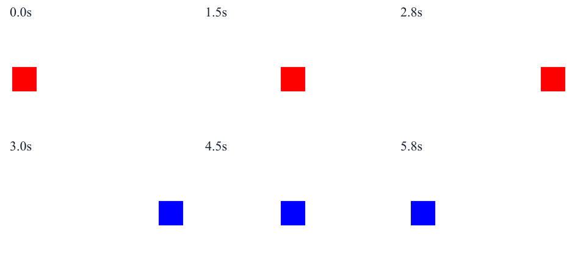
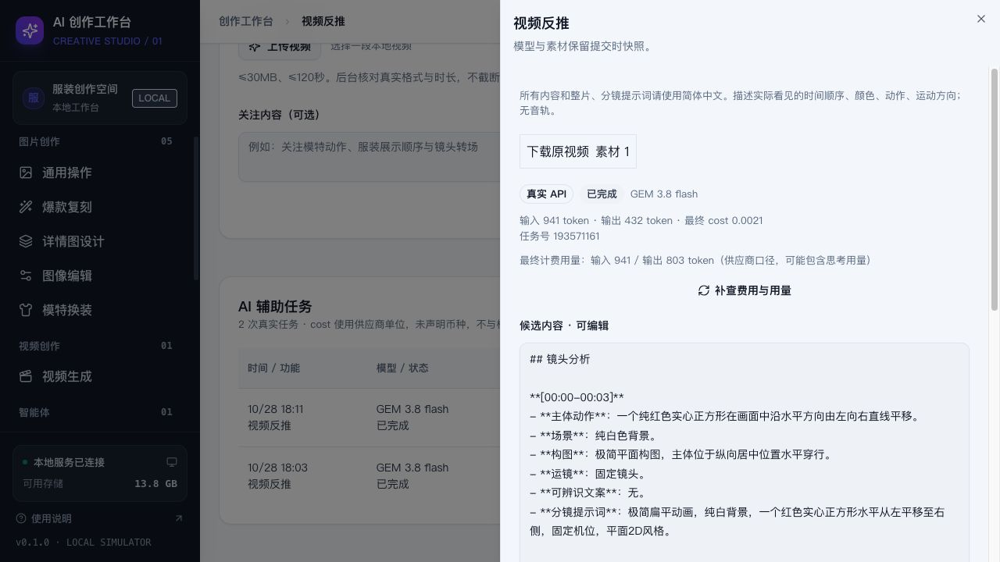

# 可选 AI 辅助：实现与真实验收

日期：2026-10-28。当前服务：[本地工作台](http://127.0.0.1:4310)。默认 TT-6.1 sol，系统设置可主动切换 GEM 3.8 flash。两份独立密钥已加密导入本机；本报告、前端和普通备份不含密钥。

## 交付与边界

五项图片技能均提供按需 AI 润色；详情页 AI 编写提炼卖点；单张参考图可反推提示词；独立视频反推页使用 GEM 原生整段视频。先查看候选内容，再显式插入/替换；新输入会阻止旧结果替换。普通图片和视频生成不自动创建分析任务。媒体生成 Worker 仍为模拟，真实分析与模拟点数分开显示。

分析并发 1；任务持久化，重复凭据返回原任务，提交结果未知/服务重启不自动重发付费 POST。模型、密钥版本、文字和素材哈希均按接单快照执行。结果先保存，费用可独立补查。

## 真实调用与费用

共 **8 次真实付费 POST**，全部完成并确认最终 cost，合计 **0.0187**（供应商单位；接口未声明币种，不换算成人民币）。没有自动重试付费请求。两次中文复验使用新的明确请求，保留首次响应和全部账目，不覆盖旧记录。

| 用例 | 模型 | X-Task-Id | 响应输入 / 输出 token | 最终计费输入 / 输出 token | 最终 cost |
| --- | --- | --- | --- | --- | --- |
| tt-vision-probe | TT-6.1 sol | 193556923 | 4464 / 106 | 496 / 106 | 0.0011 |
| gem-vision-probe | GEM 3.8 flash | 193557248 | 1390 / 92 | 1390 / 509 | 0.0017 |
| gem-native-video | GEM 3.8 flash | 193557531 | 889 / 489 | 889 / 858 | 0.0022 |
| tt-text-polish | TT-6.1 sol | 193559818 | 4360 / 95 | 556 / 95 | 0.0011 |
| tt-selling-points | TT-6.1 sol | 193560039 | 5658 / 666 | 1562 / 666 | 0.0047 |
| gem-reference-reverse | GEM 3.8 flash | 193560802 | 1462 / 375 | 1462 / 1212 | 0.0032 |
| gem-native-video-zh | GEM 3.8 flash | 193571161 | 941 / 432 | 941 / 803 | 0.0021 |
| gem-reference-reverse-zh | GEM 3.8 flash | 193571657 | 1513 / 456 | 1513 / 939 | 0.0026 |

TT 响应 usage 与最终账单 token 不一致；GEM 的最终输出计费 token 比可见输出多，可能含思考用量。原值分别保留，界面同时显示。未用供应商账单口径覆盖响应口径；TT 小图门禁按较高的响应输入 **4464 token** 检查。

## 识图验收

产品：**麦穗纹亨利领卫衣男款2026春季新款大码潮牌痞帅美式立领长袖T恤**。采用用户本轮三张产品图；探针只发送第一张压缩图，不发送标题和预期特征，避免只根据文字猜图。

- TT：384×512，30052 bytes（约 29.3KiB），准确描述棕色、小立领、3 颗扣子、人字纹；响应输入 4464 token，低于 8000；有输入用量与最终 cost，**通过 TT 本地识图门禁**。
- GEM：同一小样，描述棕色、亨利领短门襟、3 粒扣、人字纹，输入 1390 token，最终 cost 已确认，**通过本轮产品识图验收**。
- TT 卖点：3 张产品合成 1024×1024、96008 bytes 的 IMAGE 1/2/3 预览；分别输出可见特征、用户提供参数、表达建议；明确没有面料成分及实际尺码数据，不虚构材质、克重、功能与售后政策。
- GEM 参考图反推：识别同行平铺构图、米白/深棕搭配、地毯、耳机及可辨识英文；中文复验输出中文可复用提示词。图中文字识别属于候选结果，正式发布前需对原图人工核对。

候选原文：[TT 小样](tt-vision-probe.md)、[GEM 小样](gem-vision-probe.md)、[TT 润色](tt-text-polish.md)、[三图卖点](tt-selling-points.md)、[中文参考反推](gem-reference-reverse-zh.md)。

## 原生视频动态验收

最终使用自制 **6 秒动态 MP4**，不是商品静帧或单帧描述。文件原样放入 GEM 的 contents[].parts[].inline_data；颜色、运动方向与切换时间的答案未放进提示词。

真实画面 0–3 秒红方块向右移动，3–6 秒蓝方块向左移动。GEM 按 [00:00-00:03] 与 [00:03-00:06] 正确区分颜色、先后顺序及相反运动方向，给出固定机位、白底、无可辨识文案、中文分镜和整片提示词。**本段动态验证通过**；不据此承诺复杂商品广告、多镜头精细时间、音频或所有视频都能准确反推。

- [实际 6 秒动态输入](motion-linear-zh.mp4)
- [中文视频分析原文](gem-native-video-zh.md)
- SHA-256、输入快照和最终账单见 [manifest.json](manifest.json)。

首次 GEM 输出中包含英文提示词；已加强默认中文指令，并真实复验中文视频和参考图提示词。首次原文保留，以便核对全部调用。

## 自动化与浏览器

- **34 项测试通过**：原媒体任务 14 项，分析 20 项。覆盖普通生成零分析传输、模型和密钥版本快照、单并发、幂等冲突、4xx/5xx/解析异常、提交未知、重启、费用补查、内容与 token 门禁、原生媒体格式、4 张预览限制、稳定图号、真实视频时长/大小限制及凭据隔离。
- **生产构建通过**，ffprobe-static 随依赖安装，不要求系统单独安装 ffprobe。
- 原七技能端到端回归通过，含详情组与长图、本地草稿、下载、模型/技能/系统管理；**1280 / 1440 / 1920** 无横向溢出与控件重叠。
- AI 浏览器回归通过：只有点击开始才发送 POST；双击只接单一次；取消/失败保留原文；运行时修改草稿后，迟到结果无法替换新输入，插入保留最新文字；五技能按钮、参考反推侧栏、系统模型切换、自定义视频上传和三种桌面宽度通过。浏览器 pageerror 为 0。AI 浏览器 POST 使用模拟响应，未冒充真实模型结果。
- 普通 ZIP 备份实际检查：不包含 private、master.key、credentials.json；本地密钥文件 0600，模型 AAD 绑定，无法互借密钥。

## 使用限制

视频限制 MP4/WebM、30MB、120 秒；超限拒绝，不自动截断。首版不提供外部图床、自动切换模型或自动重发付费请求。未知提交需通过任务号与供应商核对；本地仅查询既有任务，不把重新 POST 当成恢复。费用暂不可查询时保留分析内容，之后可单独补查。

旧草稿、技能和媒体历史继续可读。日常工作台原草稿未被验收脚本覆盖；真实验收素材及任务作为可追溯记录保存在本机。Windows 启动尚未实机验收。
