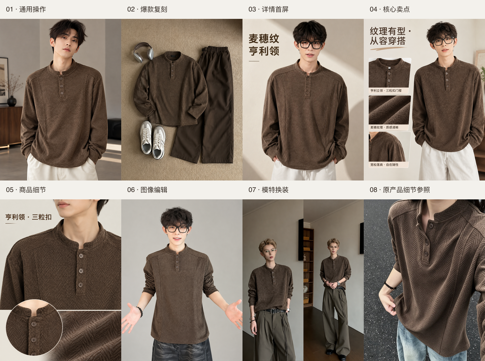

# 亨利领产品：五项图片功能真实接口实测

日期：2026-10-28。产品：麦穗纹亨利领卫衣男款2026春季新款大码潮牌痞帅美式立领长袖T恤。

五项功能共 7 张，均通过真实 TT Image 2.5 接口完成。供应商返回最终成功、文件下载成功，解码后均为 864×1152；输出 SHA-256 均与七张处理后的输入图不同。本轮不使用复制素材的模拟器生成输出。

## 调用范围与证据

真实请求由当前技能的 compilePlan 生成提示词、角色、数量与参数，再由独立实测脚本调用 https://api.lk888.ai/v1/media/generate，并查询 /v1/media/status。当前网页默认 Worker 仍为模拟，本轮没有把它标为已接入真实生成，也未覆盖日常工作台草稿。独立测试数据保存在 run-data；原 TikTok 数据库只读读取模型连接与凭据，没有迁移旧任务、修改旧系统或写出密钥。

用户提供前四张为同行，后三张为产品。同行图裁去状态栏、播放器与留白；产品图裁去白边。没有改写商品纹理与款式。同行第 4 张用于平铺复刻，第 3 张用于双栏模特换装；同行第 1/2 张作为备选保留，本轮未付费生成其变体。所有任务使用同款三张产品参考；请求为 3:4、1K、单图输出，详情展开为一组三屏。

| 用例 | 上游任务 ID | 最终状态 | 实际尺寸 | 接口 cost |
| --- | --- | --- | --- | --- |
| 01-general-1 | 193395428 | success / final | 864×1152 | 0.0395 |
| 02-replica-1 | 193399123 | success / final | 864×1152 | 0.0858 |
| 03-detail-1 | 193400724 | success / final | 864×1152 | 0.0858 |
| 03-detail-2 | 193402107 | success / final | 864×1152 | 0.0858 |
| 03-detail-3 | 193406218 | success / final | 864×1152 | 0.0395 |
| 04-edit-1 | 193407645 | success / final | 864×1152 | 0.0395 |
| 05-outfit-1 | 193408890 | success / final | 864×1152 | 0.0858 |

接口 cost 合计 **0.4617**。只累加最终成功返回的字段；接口未声明币种，不自行等同人民币或本地参考点数，最终金额以供应商账单为准。本轮没有重试付费请求。

## 视觉验收

| 功能 | 结论 | 可见结果与问题 |
| --- | --- | --- |
| 通用操作 | 基本通过 | 成年男性上身图，咖棕色、三扣亨利领与麦穗纹可见；人物重新生成，符合本项要求。纹理强弱与原图存在差异，不能当作面料精确扫描。 |
| 爆款复刻 | 基本通过 | 复用同行暖色地毯、耳机、裤装与鞋的平铺关系，白夹克变为本品；领口无拉链，未保留同行夹克标识。铺法与配饰位置重新组织，非像素级一致。 |
| 详情图设计 | 基本通过 | 主视觉、核心卖点、领口细节三屏齐全；咖棕米白配色一致，短中文标题可读，三粒扣结构基本保留。细节屏仍有生成式重绘，中文与纹理需上架前逐张复核。未验证尺码/成分等精确参数屏，也未调用 AI 编写卖点。 |
| 图像编辑 | 部分通过 | 走廊变为米灰摄影棚，眼镜、发型与张开双手姿态基本保留；但表情由微张口变为明显微笑，不满足严格只改背景；人物脸部、光线与衣物也有重绘，不算无损局部编辑。 |
| 模特换装 | 基本通过 | 双栏男模黑色拉链上衣均替换为咖棕三扣亨利领，双栏构图与阔腿裤基本保留；人物五官、姿态与配饰存在细微变化，不能承诺身份像素一致。 |

结论基于人工可见图检查；没有采用身份识别或纹理相似度模型，也不将 API 成功等同上架质量通过。产品标题中的 2026 春季、大码等来自用户，未从图片虚构尺码、成分、克重和功能。

## 详情长图与交付

共享 exportLayout 使用真实三屏，按主视觉 → 核心卖点 → 商品细节等宽无间距拼接，导出 864×3456 PNG；它是本地图片处理，不产生额外模型请求。

- [实测总览](overview.png)
- [详情长图](outputs/03-detail-long.png)
- [请求、状态、任务号、成本与文件哈希](manifest.json)
- 每项 *-plan.json 保存当时的技能计划与素材角色；不含图片 base64 或接口凭据。

## 后续改进

1. 背景编辑采用蒙版/主体锁定流程或更强局部编辑协议；当前普通多图提示词不足以保证表情和脸部不变化。
2. 详情图若要求精确文字与尺码参数，应由结构化排版输出，不能只依赖模型直接生成。
3. 把真实适配器接入网页前，仍需补齐任务提交未知、重启查询、下载重试、凭据配置、真实/模拟标识与账本隔离。此脚本保留上游任务号并拒绝自动重提未知/失败请求，但不替代完整生产 Worker。
