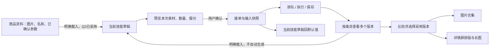

# 成套商品图工作流：已采用的交互方案

日期：2026-10-29。状态：用户已采用商品资料复用、版本比较和成套交付方向；手机范围按后续指示暂缓。本文保留设计说明，实际交付与限制见《实施与验收记录》。

## 目标与已确认边界

用户已确认核心工作是“一款商品连续产出一组成套图”。主要使用者为服装运营，工作模式为 Operate：准确、高效地做完一套图，并能继续修改、找回与导出。

保留现有视觉依据、深色侧栏、靛蓝主色、中文字体尺度、React/TypeScript/Vite、shadcn/ui 自定义控件与语义主题。AI 润色仍为小图标；普通生成不自动调用分析模型。真实余额、预计费用、实际消费继续分别表达。

**保留接单成功重置约定。** `docs/工作台结果流与输入区交互规范.md` 已明确：接单持久化成功后，当前技能输入回默认状态；失败或受理未知保留输入。商品资料复用不能被用来偷偷改成“发送后保留素材与参数”。已提交任务始终使用自己的输入/模型快照。

Q2/Q3已采用推荐路线；Q4暂缓。共享商品资料明确载入，采用关系独立保存，不合并各技能草稿。

## 整体关系：技能是方法，商品上下文帮助连续工作



“商品资料”是已采用的独立资料来源，不等同于包含全部技能草稿的“商品项目”。技能仍有自己的草稿和参数；一键对标保持独立流程，不强行套入底部输入框。不同批次的 #01 不是同一个条目，不因序号相同自动合并版本。

## 桌面工作区：一个主任务，两个可切换关注点

建议继续使用当前导航，先改善工作区，不同时重做全站分类。页面保留技能名称和一句用途说明；商品摘要使用紧凑单行，不增加一排仪表盘卡片。

### 状态 A：准备创作

```text
┌ 左侧导航 ┬ 当前技能                         后台任务 · 账户余额 ┐
│          │ 当前商品摘要（Q2已采用）             查看资料 / 载入资料 │
│          ├─────────────────────────────────────────────────────┤
│          │ 本技能结果流：正在处理 / 已保存结果                  │
│          │ 批次摘要：时间、进度、成功/失败数、详情                │
│          │ [同一条目：当前版本 + 另有N版]  [下一条目]            │
│          │                                                     │
│          ├─────────────────────────────────────────────────────┤
│          │ 商品素材 / 本技能参考   创作要求              ✧      │
│          │ 白底商品图  平铺展示  面料细节  穿搭场景              │
│          │ 模型  比例  清晰度  数量  高级参数   报价  预览生成   │
└──────────┴─────────────────────────────────────────────────────┘
```

模型、比例、清晰度、数量是常用控制；语言、业务细项和模型特有字段的具体收纳，应按技能的实际使用频率确定。与当前技能相关的快捷标签保留四项，点击只改要求，不产生 AI 请求。

素材入口必须有“商品图 / 参考图 / 模特图”等可识别角色，不能仅靠两张无文字图标区分。视觉仍可用紧凑叠放缩略图；悬浮不是唯一展开方式，点击和键盘都可用。

### 状态 B：专注审图

```text
┌ 左侧导航 ┬ 当前技能                         后台任务 · 账户余额 ┐
│          │ 当前商品摘要（Q2已采用）                         查看资料 │
│          ├─────────────────────────────────────────────────────┤
│          │ 批次：已完成4/6 · 失败1 · 排队1                      │
│          │                                                     │
│          │ [条目01  当前采用/未选用] [条目02] [条目03]           │
│          │ [完整商品缩略图，保留比例与版本入口]                  │
│          │                                                     │
│          │ 选中N张                          加入交付 / 下载原图  │
│          ├─────────────────────────────────────────────────────┤
│          │ 草稿已保存 · 素材N张 · 要求摘要            继续编辑  │
└──────────┴─────────────────────────────────────────────────────┘
```

“收起创作框”是显式操作，打开预览不擅自改变用户偏好；用户输入、选素材或改参数时不自动收起。收起不保存或提交新请求，不清空草稿。返回编辑保留要求和滚动位置。批次更新原位替换占位，不把正在检查的结果移走。

具体高度由内容和字体决定，不以压缩字号追求114px。1280×720必须能进入专注审图；200%缩放不以固定高度裁掉输入或按钮。

## 商品资料复用：提案与替代路线

**推荐路线（Q2已采用）：** 让商品图片、名称、用户确认参数可被明确载入当前技能；技能要求、参考图、比例等仍分别保存。商品原图和生成的白底辅助图标明不同来源，辅助图不能变成商品事实依据。

载入时先说明作用范围：只补空字段，还是替换本技能已有商品资料；如有覆盖，给出保留/替换选择。单独上传某技能参考图不改变其他技能。删除或更新资料不追改历史快照；历史素材失效时明确标记，不能静默换图。

接单成功后仍清空当前技能选择；若要接着做同款，由用户主动“载入当前商品资料”。不得因此自动恢复刚刚已消费的草稿。

替代路线：①仅从历史任务手动复用，不增加共享资料；②各技能继续完全独立，仅改进历史预览。二者都可先完成比较、焦点、报价与动效修复，不应等待共享资料架构决定。

## 结果：从“更多版本”到“选好这一张”

### 结果卡的职责

默认展示：完整商品缩略图、条目名称/详情屏类型、版本标识、状态、采用标识（Q3已采用）。主动作是“查看比较”；下载与更多操作次之。提示词、参数快照、供应商诊断放详情，避免每卡展开全部信息。

同一 item 的多个尝试聚合在一起；失败尝试仍可查，不藏成只剩成功图。初次生成与重新生成均保留旧图。新的成功版本不会自动替换用户已选版本。

### 比较视图

```text
┌ 条目：首屏主视觉                         版本 v1 / v2     关闭 ┐
│  商品原图/参考图        版本v1              版本v2              │
│  角色与来源             参数摘要            参数摘要            │
│  [完整展示]             [完整展示]          [完整展示]          │
│                                                               │
│ 检查要点：商品外观、版型/领口、人物一致、文字、构图              │
│ 参数差异：只列本次真实变化，不用AI臆测图像优劣                   │
│ 已采用v1 / 尚未选择             下载当前图  编辑  采用此版本     │
└───────────────────────────────────────────────────────────────┘
```

原图与参考图可切换角色，但始终能找到；默认最多比较两个结果，更多版本在同一处切换，避免一次铺开十张。缩放保持对象可见，任何同步缩放是显式选项，不能把不同比例的图强裁成一致。

“采用此版本”只改变选用关系，不调用模型，不删除其他版本，不改变历史执行参数。若该结果属于同一条目的另一次生成，使用 itemId 和 attemptId 对应，不能靠屏号或缩略图位置猜测。成套交付汇总各批次的采用版本，并可按商品资料筛选。

## 交付：分清图片合集与长图排版

**推荐路线（Q3已采用）：** 用户先选用版本，图片合集与详情长图都从明确选定的产物开始。普通图片可以加入合集；长图默认只承接详情屏及用户明确加入的图，不把所有不同技能结果自动拼成一张。

交付摘要显示“已选N张 / 待完成M张 / 未选择K项”；允许明确导出部分结果，但必须列出未包含项，不伪称整套完成。没有采用版本时可手动选择，不能偷偷把最新成功图当成已确认成品。

排版右侧面板保留当前功能：选屏、选版本、拖序/上下移、宽度、间距、背景、格式。默认主要操作是“保存并下载长图”，另有“保存排版”；按钮必须与下载同时保存的真实行为一致。关闭未保存编辑时给“保存 / 放弃 / 继续编辑”。仅排序或下载不触发模型调用。

导出进行中保持任务说明，重复点击复用同一集合的导出状态；若现有后端不支持后台导出，需要作为独立能力补齐，界面不能提前承诺关页继续。已生成的包或长图对应一个确定版本的素材清单，之后改图不应使旧下载链接内容悄悄变化。

替代路线：只以单图合集为主，长图作为次级工具；或以详情长图为主，普通图片单独下载。这项选择决定默认完成动作，尚不决定后台表结构。

## 付费、AI辅助、保存：三个动作合同

| 动作 | 点击前知道什么 | 点击后发生什么 | 不发生什么 |
|---|---|---|---|
| 预览生成 | 本次输出数，预计费用或不可报价原因 | 校验并展示素材、参数和报价 | 不调用生成模型，不清空草稿 |
| 确认生成 | 真实/模拟来源、最高报价、余额、素材范围 | 核价接单；持久化确认后重置对应草稿 | 不清除提交后新输入；未知时不自动重提 |
| 重新生成 | 重用快照、具体条目、本次费用 | 确认后创建新尝试 | 不覆盖原图，不重跑整批 |
| 仅重试保存 | 已有媒体，仅保存失败 | 重试本地保存 | 不发起新模型调用 |
| AI润色/卖点/反推 | 素材、分析模型、运行状态 | 显示候选；采纳才改输入 | 不因打开面板就调用，不自动替换草稿 |
| 采用版本 | 正在选用哪个条目、哪个版本 | 更新选用结果（Q3已采用） | 不生成，不删除其他尝试 |
| 保存/下载排版 | 包含哪些图、版本、顺序与尺寸 | 保存布局/输出文件，说明实际行为 | 不增加生成费用 |

报价后台刷新与参数改变分开处理：刷新中保留上次数值并明确刷新状态；参数变更后旧报价标为失效。提交必须拿到满足规则的最新核价，不允许只因按钮保持稳定就提交旧参数价格。供应商未提供固定单价时展示区间及其原因，不把区间伪装成已承诺定价。

## 全部任务与管理页

“全部任务”先帮助找回工作：商品缩略图/名称（仅在有真实来源时显示）、技能、时间、成功数、异常数及继续入口。没有商品名的旧记录保留批次与时间，不自动编造名称。媒体创作与AI辅助分别筛选；供应商任务号查询进入高级查询。来源、用量、退款和诊断在需要时可查。

算力页维持一条净消费曲线和一张明细表，余额全局显示；补查费用与刷新失败保留最后有效数据及时间。模型配置先呈现适用任务、能力、完整价格与线路状态；官方模型名保持准确，参数与帮助中文。系统设置明确即时保存或待保存，不以关闭按钮冒充取消。

## 桌面范围与实施

手机查看、下载及手机创作均暂缓。本轮实施商品资料、收起创作框、版本比较与采用、图片合集、详情长图、历史找回和弹层动效，按1280/1440/1920桌面宽度验收。未增加后台持久导出任务；本地导出不承诺关页继续。

真实媒体接口属于单独生产阻断，必须并行排入工程计划；不能因UI修复完成就宣称产品生成能力已经验收。

## 决策状态

用户已授权落实本方案，无需重复确认。商品资料和采用关系边界已记录ADR；执行结果和未覆盖项以《实施与验收记录》为准。
