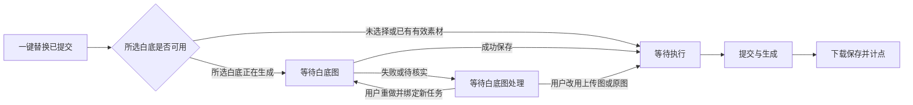

# 一键对标：逐图工作台与后台队列

日期：2026-10-28  
状态：Q5–Q7 与整体理解已由用户于 2026-10-28 确认，方案定稿；尚未开发。

一键对标属于完整流程智能体，不显示普通技能的底部输入区。上传、白底准备、替换参数和动作均位于本流程内；提交后保留本流程的商品与配对资料以供逐图处理，不套用普通技能底部输入区的初始化规则。通用结果卡与媒体预览规范见 [结果流与输入区](工作台结果流与输入区交互规范.md)。

## 1. 两个明确操作

**生成白底图**是用户主动点击的独立任务，不是进入一键对标的必经步骤。可只使用原商品图，也可添加已有白底图。

**一键替换**为勾选的同行参考图创建条目与生成尝试。选择使用某个白底任务时，不必等白底图生成完再点击；后端立即持久化替换任务及依赖，显示“等待白底图”，待该任务成功保存产物后自动进入可调度队列，无需额外审核。

仅点击“生成白底图”不会自动替换整组图。依赖必须指向用户选定的具体白底任务 ID，不指向“最近生成的一张图”。期间生成另一张白底图不会悄悄改变已排队项的引用。

## 2. 每张同行参考图一个 item

```text
┌─────────────────┬──────────────────────────────┬───────────────────┐
│ 左：同行爆款图片 │ 中：本 item 的参数与参考素材   │ 右：生成结果/状态  │
│                 │ 模型 / 画幅 / 每图版本数      │ 等待白底图         │
│ 缩略图，点击放大 │ 商品原图、白底图、额外参考缩图 │ 排队 / 生成中      │
│ 勾选、目标说明   │ 点击缩略图放大，添加/移除      │ 成品、失败原因     │
│                 │ 默认系统提示词 · 编辑入口     │ 下载、再次生成     │
└─────────────────┴──────────────────────────────┴───────────────────┘
```

每个 item 默认一张成品，需要多版时在同一 item 下显示各版本尝试。一个 item 对应一个目标图，不将每个引用角度图当作新的 item。

中间默认展示参数及素材缩略图，提示词正文可折叠，但始终有“编辑提示词”入口。默认参考包含用户商品上传图、当前目标图，以及本次已选白底图/白底任务结果；白底未选择时不自动增加。用户可额外添加或移除辅助参考，核心商品图与目标角色仍需满足执行条件。

等待中的白底结果显示占位缩略卡，标明任务状态，不能以旧图冒充已绑定的新白底图。成功后替换为真实缩略图，点击弹窗放大。引用数量、模型专有参数和预计点数随当前配置更新。

三栏 item 使用统一基础高度与缩略图框，批量参考和必要的配置可按行增加高度。提示词正文默认隐藏，通过编辑/预览入口打开；结果 item 共用预览提示词、复制提示词和重新生成操作，批次提供打包下载。界面素材不显示文件名，以角色与序号区分。

统一参数可批量应用，但只修改用户勾选的未提交项，显示影响数量；不静默覆盖已有单项设置或已提交尝试。

## 3. 排队编辑与提交锁定

用户确认 Q6：**尚未提交模型的条目可编辑；已提交的输入锁定，修改用于新尝试。**

- 草稿或等待依赖/排队时，可改参考图、参数、提示词；点击保存后生成新条目修订，更新计划和估算。
- Worker 提交前原子领取并固定修订。用户保存和 Worker 领取通过预期修订/提交状态检查竞争；不能界面显示保存成功、上游却执行另一版本。
- 若保存时已进入提交临界区，后端返回明确冲突，保留本地修改并提供用于新尝试；不得修改可能已经送出的本次请求。
- 已提交/生成中/成功/失败记录保留其执行快照；修改不覆盖旧图、旧日志与旧算力。再次真实调用需用户明确启动。
- 白底依赖只有产物 ID 的受控解析可以在成功后补齐，其商品输入、任务 ID、图像角色等已经固定；这不等于任意覆盖任务快照。

系统集成提示词来自已发布技能修订。单 item 的提示词编辑是该条目的覆盖稿，不修改全局技能文件；设置中发布技能才影响后续新的默认。未提交项也不因模板更新被静默换稿。

## 4. 状态和白底失败处理



用户确认 Q7：白底失败不将全部依赖项直接判为失败。提供“重做白底图”“改用上传图”“改用商品原图”，记录用户选择和受影响的未提交 item，校验后自动继续。不得自动降级到原商品图或其他白底图。

重做白底是新生成尝试，显示新增预计点数；原失败不计本机点数。提交未知不得直接点重做重复调用，需先核实原上游是否受理；其依赖仍可由用户主动改为其他可用参考，但不会取消或重发原未知调用。

其他已经就绪、与该白底无关的任务继续运行。已提交 item 的引用不参与本次批量改动。

## 5. 默认 20 个并发，设置可修改

“20 个同步队列”按用户需求落实为：**一条持久化图片队列，默认最多 20 个图片生成尝试同时处于提交/上游执行阶段**，不是 20 个各有 20 并发的独立队列，也不是最多只允许上传 20 张。

所有图片能力、白底生成与逐图替换共享该上限，不是每批各 20。视频使用独立可配置上限，仍遵守其供应商并发与限流；不因为图片设置为 20 就无条件向视频供应商同时发 20 次请求。

图片有效并发取全局配置与已知供应商/模型限制的交集。若供应商允许，20 个就绪尝试可并行，不等待前一张结果；后台设置显示限制来源，不默默降成逐张串行。

等待白底、等待用户处理、普通队列中未开始的项不占活动槽。状态轮询与下载有独立轻量调度，不应因为上游 20 项执行而完全停摆。已持有上游 ID 的生成在轮询间隙仍占活动生成数，不能每次查询后释放成新请求槽，导致超发。

提交未知项隔离为待核实，不堵住正常工作槽，但列出供应商实际并发可能不确定的数量，原项不自动重交。对已明确受理的限流不能靠忽略未知项声称绝无超发风险。

上调上限对新调度生效；下调时不取消已有生成，待活动数自然降到新上限后再派发。就绪批次间轮流派发、每轮每批领取一项，批内按创建顺序；只有一个批次时可用满空闲槽。新批次参与下一轮，不取消在途任务；等待依赖项不阻塞后面就绪项。429/临时限流退避处理，是否已受理未知时不能盲目重提交。

## 6. 后端动作与复用

两个操作仍复用通用创作 API、Worker、素材与点数流水，不为白底另写一个浏览器内执行器。

- 生成白底动作创建独立任务，返回任务/尝试编号，可在其他替换批次中引用。
- 一键替换提交已选目标清单及各项配置，引用已有素材或指定上游白底任务。外部依赖校验项目归属、产物类型及无环性。
- 逐图编辑带预期 item 修订；改用其他依赖作为明确的后端命令，事务保存新绑定、条目修订、状态与事件。
- 所有已提交操作关闭页面、切换能力和刷新后继续。重启恢复依赖与已受理任务，不能把未看到结果当成需要再生成。

技能 Markdown 约定 `actions.prepareWhite`、`actions.replaceSelected` 两个入口，后者通过依赖绑定引用前者任务。仅点击白底动作时不创建任何替换尝试；运行时绑定不是在 Markdown 中保存实际任务编号。

## 7. 算力与验收

Q4 已确认保存成功计点、失败不计、未确认单列。白底和替换分别按实际成功尝试统计；同一白底任务被多个 item 引用只统计一次，已有图不产生新消耗。队列中显示预计，不冻结、不因参考余额不足拦截。

验收至少包括：

1. 白底正在生成时点击一键替换，item 已落库并显示等待；关闭页面后依赖成功仍自动执行。
2. 未生成白底直接替换，或使用已有白底图，均不新增白底调用。
3. 三列 item 可查看原图、参数/参考缩略图、提示词编辑入口与结果；图片均可放大。
4. 未提交项保存编辑与 Worker 领取发生竞争时，能准确说明实际执行版本，不静默丢改动。
5. 白底失败后重新绑定上传图/原图或新白底任务，仅恢复相应未提交项，其他任务继续。
6. 25 个就绪图片任务在测试供应商允许时活动数最多 20，其余排队；等待白底的项不占槽。
7. 将并发从 20 下调不取消已执行项，上调可派发更多就绪项；跨批次共享限制。
8. 用户明确单张再生成创建新尝试且绕过旧成品缓存；同一次操作的重复提交、重启恢复不重复创建或计点；依赖引用不重复计白底点数。
9. 大批次与新单图批次共享空闲槽，轮转不会让单图等待整批未提交项完成；完整规则见 [可靠性与运营效率补充](首版可靠性与运营效率补充.md)。
