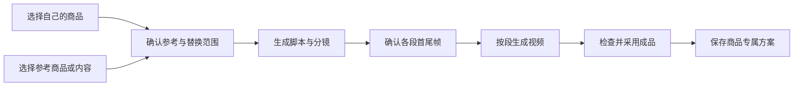

# 多市场、多语言与商品专属智能体扩展方案

日期：2026-11-04  
状态：设计方案，供评审；本文不代表相关功能已经实现。

## 1. 目标与已确认方向

现有系统主要面向国内抖音服装业务。新增菲律宾 TikTok 3C 业务，同时支持以后增加其他国家、语言、平台和商品类目。

采用一套系统、多个业务空间、共用商品和生成能力的方案。业务空间保存市场与语言等默认配置，不复制整套应用。

已确认的设计约束：

- 商品编辑保持通用，取消类目专属字段和强制参数表单。
- 平台、国家、语言、类目分别保存，界面可以组合展示。
- 通用智能体和通用提示词允许选择市场、语言、商品等配置。
- “专属智能体／专属提示词”指针对某个具体商品优化并保存的方案，不是国家或类目专属。
- 商品工坊保留现有军埔网、1688 来源，并扩展 TikTok 在线商品和参考内容。
- 商品资料、参考商品资料、参考创意分别保存，采用关系明确。
- 页面保持简洁，详细说明进入帮助中心。

## 2. 方案选择

| 方案 | 设计 | 评价 |
| --- | --- | --- |
| 全局开关 | 所有页面共用数据，通过平台、地区开关改变行为 | 初期快，但草稿与默认规则容易串用 |
| 多业务空间，共用能力 | 空间保存默认配置，商品、任务、素材有明确归属和引用关系 | 推荐，适合持续扩展 |
| 独立海外系统 | 复制一套系统独立维护 | 隔离明确，但功能升级、修复和模型接入需要维护两份 |

推荐第二种。空间可以引用同一个商品主档，分别建立当地销售资料和内容作品。

## 3. 配置维度与扩展方式

| 维度 | 作用 | 示例 |
| --- | --- | --- |
| 平台 | 内容形式、来源适配、交付规范 | 抖音、TikTok，后续可扩展 Shopee |
| 国家／地区 | 币种、时区、价格格式、当地表达规则 | 中国、菲律宾、马来西亚 |
| 类目 | 分类、模板推荐、适用功能 | 服装、3C、美妆、家居 |
| 内容语言 | 文案、口播、字幕的语言 | 中文、英语、Filipino |
| 表达风格 | 同一语言下的语气和混合表达 | 正式、日常、Taglish |
| 业务空间 | 保存上述配置的常用组合，组织商品和任务 | 国内服装、菲律宾数码 |

国家与语言独立。菲律宾市场可以使用英语、Filipino 或 Taglish，不根据国家强制固定语言。

Taglish 保存为语言及表达风格组合，允许调整混合程度；系统界面直接提供“Taglish”快捷选项即可。

### 3.1 扩展边界

- 新增国家：增加市场配置、币种及内容规则，按实际情况验证来源访问能力。
- 新增语言：增加语言配置、模板、字体及排版支持，并验证模型的文本、口播、字幕能力。
- 新增类目：增加分类标签、示例和创作模板，不增加专属商品表单。
- 新增平台：通常需要开发来源适配器、交付规范和预览适配，不能保证仅靠配置完成。
- 新增商品专属方案：从实际优化结果保存，不需要开发新页面。

## 4. 业务空间

### 4.1 新建空间

建议只要求填写：

| 配置 | 示例 |
| --- | --- |
| 名称 | 菲律宾数码 |
| 投放市场 | TikTok · 菲律宾 |
| 默认类目 | 3C |
| 文案语言 | 英语 |
| 口播语言／风格 | Taglish |
| 字幕语言 | 英语 |
| 销售币种 | PHP |

后台分别保存平台与国家，界面使用一个“投放市场”选择框降低操作成本。

### 4.2 空间与数据关系

- 同一商品主档可以被多个空间引用。
- 当地售价、店铺链接、当地标题和销售规格按市场销售资料保存。
- 创作草稿、专属方案的适配版本和生成任务记录保存所属空间。
- 切换空间分别恢复草稿，不覆盖另一个空间的输入。
- 公共模板可以跨空间使用；商品专属方案默认优先展示在关联商品下。
- 空间分类用于工作组织；多人权限隔离属于后续独立设计范围。

## 5. 通用商品资料

取消类目专属字段。所有类目使用同一套商品编辑界面：

| 字段 | 填写方式 |
| --- | --- |
| 商品名称 | 文本 |
| 商品图片与视频 | 上传、图片库选择、来源采集 |
| 规格／版本 | 可选，自由填写名称；需要时关联对应图片 |
| 商品资料 | 一个文本区域，填写参数、功能、使用方法及注意事项 |
| 已确认卖点 | 文本，可由 AI 提炼候选后采用 |
| 成本与币种 | 数值与币种选择 |
| 当地售价与币种 | 保存在市场销售资料中 |
| 来源链接 | 可关联多个来源 |
| 类目 | 分类标签，不触发复杂必填表单 |

例如充电器的接口、功率、协议和兼容设备，都写入商品资料，不额外设计充电器专属表单。

采集信息保留原始快照。AI 可以整理资料和提炼候选卖点，但不能把竞品参数、模糊图片推断或未确认信息自动写成已确认事实。

## 6. 商品、市场商品与参考内容

| 对象 | 内容 | 用途 |
| --- | --- | --- |
| 商品主档 | 自己商品的资料、原图、规格与来源 | 创作的商品事实及外观依据 |
| 市场商品 | TikTok 在线商品、店铺、当地价格、来源快照 | 选品、价格比较、关联同款 |
| 参考内容 | 图片、视频、脚本、分镜、页面布局 | 参考表达方式或替换商品 |
| 市场销售资料 | 商品在某市场／店铺的标题、价格、销售规格 | 本地化经营与内容创作 |
| 内容作品 | 指定市场、语言和商品的创作版本及成品 | 采用、复用、导出 |

典型使用方式：

1. 从 1688 导入自己的商品。
2. 关联菲律宾 TikTok 上的同款或相似商品。
3. 添加一个优秀演示视频作为参考。
4. 用自己的商品资料重写脚本并替换商品。
5. 保存效果好的提示词或完整流程为商品专属方案。

同款关联由用户确认。外观相似不自动等于同型号、同规格或相同性能。

## 7. TikTok 采集设计

### 7.1 采集入口

- 商品链接：进入商品资料或市场商品导入流程。
- 视频／图文链接：进入参考素材流程。
- 手动补充：上传图片、视频、页面文件或填写商品资料。

粘贴链接后先识别来源与地区，展示可读取内容预览，再选择导入用途。

### 7.1.1 可见浏览器与人工确认采集

TikTok 优先采用用户参与的浏览器采集流程：

1. 用户在商品工坊粘贴链接，点击“打开采集窗口”。
2. 打开真实、可见、可交互的浏览器页面，保留本地浏览器会话。
3. 遇到登录或验证码时显示“等待用户处理”，用户直接在该页面操作。
4. 商品详情可见后，用户点击“一键采集当前商品”。
5. 采集器读取当前已验证的页面及该商品可访问的素材，展示结果预览。
6. 用户选择“导入为我的商品”或“作为参考商品”，完成保存。

“一键采集”入口优先放在浏览器扩展侧栏或扩展提供的悬浮工具条中，同时提供工作台的“返回采集窗口”。这需要实际开发并安装适配扩展，不把 TikTok 自身页面描述成已有该按钮。

用户完成验证后继续使用同一页面和会话，避免另起无登录状态的后台请求重新撞上验证。媒体文件是否能获取仍需单独校验；标题读取成功不等于全部图片和视频下载成功。

采集前核对当前地址、商品 ID 与地区。如果用户已导航到另一个商品，则提示按当前商品采集，不沿用旧链接身份。关闭页面、会话过期或再次出现验证时，保留任务并提示重新打开或人工处理，不无限重试。

采集状态建议为：等待打开页面 → 等待用户处理 → 等待点击采集 → 读取资料 → 下载素材 → 待确认导入 → 完成／部分完成。验证码通过与资料可读取分别判断，不假定通过验证就能消除地区访问限制。

### 7.2 实际链接样例

用户提供的链接：

<https://shop.tiktok.com/view/product/1737362750199137604?region=PH&locale=zh-CN&source=agency>

| 链接内容 | 识别结果 |
| --- | --- |
| 商品 ID | `1737362750199137604` |
| `region=PH` | 菲律宾市场 |
| `locale=zh-CN` | 页面显示语言为中文 |
| `source=agency` | 来源标记，不用于决定创作语言 |

页面语言与内容输出语言分别保存。中文展示页面也可以用于生成英语或 Taglish 内容。

2026-11-04 使用 BrowserOS neo 实际访问时，页面提示“此国家或地区未提供的商品，请重试”，未读取到商品标题、价格和图片。本链接目前只验证了地址识别，尚未验证完整商品采集。

同日再次访问出现 Security Check 滑块验证码；本轮按用户要求跳过验证，未读取验证码后的商品详情。此状态说明采集流程需要人工接管入口，验证码后的详情读取尚待验证。

不能仅凭该提示认定商品下架或售罄。需要继续验证实际访问环境、地区和登录条件。

### 7.3 采集结果与异常处理

- 能读到哪些字段，就展示哪些字段；缺失内容标记“未获取”。
- 价格保留币种、价格类型及采集时间，区分原价、活动价和券后价。
- 销量、评价等数据保留来源口径，不自动解释为商品效果证明。
- 同商品 ID、同地区、不同页面语言的链接归入同一市场商品，保留不同来源快照。
- 同商品 ID、不同地区的记录分别保存，再按需关联。
- 重新采集只创建新快照，由用户选择更新，保留手工编辑内容。
- 无法访问时提供“打开原链接”“重新采集”“手动补充”，不显示虚假的采集成功。

来源适配器分别处理地址、访问方式、解析、媒体和异常。官方授权接口能否获取目标商品、浏览器能读取哪些内容，需要按实际来源验证，不预设任意竞品都可以通过接口采集。

## 8. 通用智能体与通用提示词

### 8.1 通用输入

| 配置 | 说明 |
| --- | --- |
| 关联商品 | 自动带入资料和已选择素材 |
| 投放市场 | 如抖音 · 中国、TikTok · 菲律宾 |
| 内容语言 | 文案语言，视频可分别设置口播与字幕 |
| 创作要求 | 开箱、演示、场景、商品替换等 |
| 参考内容 | 可选图片、视频或已有作品 |
| 模型与生成参数 | 按步骤选择或使用已保存默认值 |

通用提示词负责一个步骤，例如图片、脚本或视频提示词。

通用智能体组合多个步骤，例如商品资料整理、方向、脚本、分镜、首尾帧、视频和检查。

### 8.2 配置应用规则

空间提供默认值，用户可以对当前任务调整。提示词模板明确区分可填写变量与固定内容，执行前展示最终提示词。

商品事实、参考素材用途、模型能力和实际生成参数作为执行约束。市场与语言配置不能自动创造商品参数。

## 9. 商品专属提示词与商品专属智能体

### 9.1 准确定义

“商品专属”指针对某一个具体商品优化并保存的内容或流程。

例如：

> ABC 充电器 · 菲律宾 Taglish 演示 · 已优化版

它不是“菲律宾 3C 通用专家”的别名，而是与 ABC 充电器实际素材、脚本和效果关联的可复用方案。

| 类型 | 保存内容 |
| --- | --- |
| 商品专属提示词 | 某一步已优化原文、商品与素材绑定、变量、适用市场和语言、相关模型参数 |
| 商品专属智能体 | 完整步骤、每步提示词版本、素材绑定、模型与分组选择、参数、检查点及采用结果 |

### 9.2 保存与复用

1. 在商品或生成结果中点击“存为商品专属提示词／智能体”。
2. 填写名称，选择保存范围，确认绑定商品和素材。
3. 保存固定版本，并关联参考成品。
4. 下次打开时自动带入商品及默认配置，展示本轮输入与报价。
5. 用户启动后执行，记录本轮任务，保留历史结果。

“已优化”与“真实生成已验证”分开标记。仅保存过文字的方案，不自动标为真实验证通过。

### 9.3 原文与版本保护

- 不自动润色或改写已经优化好的提示词。
- 可变部分由用户明确设置，例如售价、场景或促销文案。
- 更换语言、市场或商品时，创建适配副本，不覆盖原版。
- 原商品资料或素材变化时展示差异，由用户决定沿用或更新。
- 凭据只保存配置引用，不把 API Key 写入方案正文或导出文件。
- 模型、分组或素材不可用时明确提示，不静默替换。

## 10. 商品替换与视频制作流程

支持以下不同操作：

| 操作 | 行为 |
| --- | --- |
| 导入为我的商品 | 采用资料前确认商品和规格 |
| 关联同款 | 建立关系，保留各自来源与市场数据 |
| 参考图片 | 使用构图、风格或场景，商品外观使用自己的素材 |
| 参考脚本 | 提取表达结构，用自己的事实重写 |
| 替换视频商品 | 选择整片或指定镜头，按自己的商品重做 |



每个生成段保存首帧、尾帧、对应提示词及参考素材。页面使用紧凑摘要，点击编辑进入二级弹窗。

首尾帧传入视频时明确顺序，并按所选模型能力校验。3C 接口、插孔、线材连接和屏幕内容等关键结构，允许采用原图保留、局部编辑或合成方式。

先把现有流程中的图片生成、结果绑定、视频交付连通，再对外提供“一键执行”。不能用页面跳转和手工复制代替已完成的一键链路。

## 11. UI 设计

### 11.1 全局空间切换

```text
业务空间 ▾
  国内服装
  菲律宾数码
  马来西亚数码
  ＋新建业务空间
```

选中空间后，顶部展示简短的市场与类目摘要。详细配置放在空间设置中。

### 11.2 商品工坊

```text
商品工坊                         [采集链接] [新建商品]

我的商品    市场商品    参考素材

来源：全部 ▾    类目：全部 ▾    状态：全部 ▾    搜索…
```

商品详情导航建议统一为：

```text
商品资料｜市场与参考｜内容创作｜视频复刻｜专属方案｜任务与成品
```

商品资料用通用字段；市场与参考负责当地销售资料、来源商品和参考内容；专属方案集中显示当前商品保存的提示词与智能体。

### 11.3 智能体与提示词中心

```text
智能体／提示词

通用    商品专属    我的收藏

市场：全部 ▾    语言：全部 ▾    关联商品：全部 ▾    搜索…
```

卡片显示名称、关联商品、适用市场、语言和验证状态。编辑原文、查看历史版本等操作进入详情，不在卡片堆叠说明。

### 11.4 创作配置

```text
商品：ABC 充电器
投放市场：TikTok · 菲律宾 ▾
文案：英语 ▾    口播：Taglish ▾    字幕：英语 ▾

[参考素材] [查看最终提示词] [预览报价并生成]
```

纯图片任务只展示有关配置。市场销售价格使用当地币种；生成费用继续使用中转站实际计费单位，独立展示。

操作界面可以保持中文，内容输出语言独立。多语言版本在同一作品下切换，每个版本单独保存和采用。

## 12. 技术结构与兼容

建议在现有结构上增量增加以下对象：

| 对象 | 职责 |
| --- | --- |
| 业务空间 | 市场、语言、类目默认配置与组织归属 |
| 商品主档 | 通用资料、规格、素材、已确认卖点 |
| 来源商品与快照 | 来源平台、商品 ID、地区、页面语言、采集时间、原始资料 |
| 市场销售资料 | 商品、市场、店铺、当地标题、价格及销售规格 |
| 参考关系 | 商品、市场商品、素材及参考用途之间的关系 |
| 提示词模板与版本 | 原文、变量、适用范围、商品绑定、验证结果 |
| 智能体定义与版本 | 步骤、提示词引用、模型配置和检查点 |
| 执行记录 | 输入、步骤状态、费用、产物及来源版本快照 |

现有商品、草稿、素材和任务保留。旧数据默认归入“国内服装”，旧颜色和尺码记录继续可读，逐步适配为通用规格／版本。

当前主要改动位置：

- `packages/catalog.ts`：商品、来源和规格结构。
- `apps/server/catalog-collection.ts`：来源识别与采集调度。
- `src/components/catalog/editor.tsx`：通用商品编辑、市场资料与专属方案入口。
- `packages/research.ts` 及相关创作规则：移除写死的服装、中文、国内抖音默认假设，改为显式上下文。
- 提示词工作台、图片与视频任务：携带市场、语言、商品和模板版本。

### 12.1 任务快照

每次提交锁定商品版本、所选规格、市场、语言、提示词版本、智能体版本、素材及模型与分组。后续修改配置不影响已提交任务。

### 12.2 续跑与费用

- 每一步保存状态与产物，刷新或恢复后继续查看。
- 成功步骤可以复用，只补做失败或明确要求重做的步骤。
- 已知供应商任务只查询状态；提交结果未知时先核对，不能直接再次付费提交。
- 执行前按阶段汇总报价，模型或价格发生变化时展示差异。
- 不同中转站分别显示余额和实际计费单位，不自动把算力换算成人民币。
- 本方案的“一键”范围为内容制作；自动发布平台属于独立能力，需要另行设计。

## 13. 实施顺序

### 第一阶段：兼容基础

新增业务空间、投放市场、语言配置；商品编辑统一为通用字段；清理创作流程中写死的中文、服装和国内抖音规则。用已有 1688 商品完成菲律宾内容创作。

### 第二阶段：TikTok 来源与参考关系

验证菲律宾实际商品链接与视频链接；完成导入预览、市场商品、来源快照、同款关联和手动补充。

### 第三阶段：商品专属方案

支持保存专属提示词、保存完整智能体、版本管理、绑定商品与素材、创建市场／语言适配副本。

### 第四阶段：执行链路

打通脚本、分镜、首尾帧、视频和成品采用，完善进度、续跑、失败补做与费用核对。

### 第五阶段：扩展验证

增加一个新市场和一个新类目，例如马来西亚及家居，验证通用商品表单、配置及模板能复用，避免只针对现有两个业务写死分支。

## 14. 验收标准

| 场景 | 通过条件 |
| --- | --- |
| 国内兼容 | 原商品、草稿、历史任务正常读取，原国内流程可继续使用 |
| 新类目 | 不新增专属商品表单即可录入、采集和创作 |
| 市场切换 | 空间草稿分别恢复，不串用售价、语言和素材 |
| 多语言 | 文案、口播、字幕可分别选择，并保存独立版本 |
| TikTok 导入 | 能识别来源、商品 ID、地区和页面语言；无法读取时明确标记 |
| 商品参考 | 竞品参数不自动进入自己的已确认商品事实 |
| 商品专属提示词 | 保存后原文不被自动改写，变量与固定内容明确 |
| 商品专属智能体 | 保存完整步骤及版本，复用时能预览输入、模型和报价 |
| 适配副本 | 更换市场、语言或商品保留原方案 |
| 首尾帧视频 | 图片与生成段关联正确，视频提交顺序正确，结果可回到作品 |
| 恢复与补做 | 已完成步骤保留，不因刷新重复提交付费任务 |
| 费用 | 报价、供应商、实际单位和结算状态可追溯 |

第一轮完整验收建议采用一款真实 3C 商品、一份菲律宾 TikTok 参考内容，完成资料确认、语言选择、脚本、首尾帧、视频、成品采用及商品专属方案保存。采集暂不可用的步骤应记录为阻塞或手动补充，不冒充自动采集通过。
