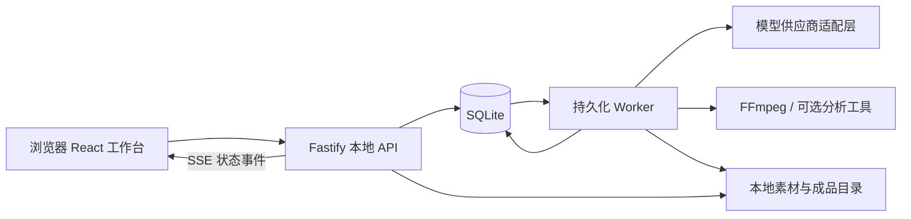

# AI 创作工作台：产品与技术方案

日期：2026-10-28  
项目目录：`/Users/hc-sonic/Documents/douyin-creative-studio`  
状态：用户已于 2026-10-28 确认整体理解，方案定稿；尚未开发应用或启动脚本。本文中的模型、界面、接口和目录结构为待实施设计。

## 1. 产品定位与核心建议

系统正式命名为 **AI 创作工作台**。页面标题、侧栏品牌、启动提示与发布包展示名统一使用该名称；抖音男装是首期业务定位。

做一个面向国内抖音服装运营的本地 AI 创作工作台，先服务男装，再扩展女装、鞋包等品类。运营上传商品图，选择创作能力，填写少量参数即可提交；服务端持续生成，用户回来后查看、修改、下载成品。

前端技术选型已确定为 **React + shadcn/ui + Tailwind CSS**，配合 TypeScript 与 Vite，视觉方向为现代 AI 科技感与潮牌电商风。后端采用 **Fastify + TypeScript + SQLite + 持久化 Worker + FFmpeg**。Windows 发布包内置运行环境，通过 `run.bat` 启动本地服务并打开浏览器。

媒体接入已确定：**图片默认使用 TT Image 2.5，视频默认使用原系统的 Omni，并保留其他已配置视频模型的扩展能力；复用原系统已有的媒体 API 协议与调用逻辑。** 面向国内抖音的是产品流程、语言和创作内容，不要求另换一套模型供应商。

核心设计取舍：

1. **任务优先，商品可复用。** 不要求每件商品先新建项目、做研究、走完整流程。一次提交就是一次任务；商品档案按需保存，方便重复创作。
2. **普通生成直接提交。** 图片和普通视频不增加“先生成提示词，再点生成”的中间环节。后端根据模板组织请求，缺少必要信息时在提交前提示。
3. **智能体复用同一执行框架。** 首期仅提供图片类“一键对标”：默认直接使用商品原图，将已勾选对标图中的服装替换为自有商品，白底图可选。不引入视频分析工坊。
4. **独立 React 前端，业务重新收敛。** 通过 shadcn/ui 建立现代 AI 与潮牌电商风的组件体系，复用旧系统可靠的业务协议与后台经验，避免完整复制旧系统的多重版本、多个相似入口与复杂前置流程。
5. **本地运行、联网生成。** 媒体、任务、历史保存在本机；调用云端模型时仍需网络和 API 额度。

首期定位单机、单操作员，不包含局域网多人协作、抖音账号托管、自动发布或桌面壳。后续可增加桌面壳，业务 API 无需重写。

抖音链接导入、爆款视频智能体、文本模型反推视频提示词、收藏与国内灵感库为后续扩展。首版只预留可复用契约，严格优化现有五项功能的前后端与 UI，不提前增加入口或大型依赖。架构评审与验收标准见 [首版框架优化与后续扩展](首版框架优化与后续扩展.md)。

## 2. 男装场景中的真实需求

男装创作的重点是：商品能够识别、穿搭有购买理由、使用场景真实、结果可以批量复用。

| 运营需求 | 工作台处理方式 | 关键边界 |
| --- | --- | --- |
| 同一款衣服需要不同宣传图 | 使用图片生成，上传参考并设置数量与差异 | 保留新品款式；只按明确要求添加宣传文案 |
| 新款沿用成熟场景 | 商品参考与场景参考分开上传 | 场景取参考图，商品取新品图，去掉旧商品文案 |
| 展示上身和搭配 | 场景上身、整件换装、图案替换 | 明确模式，锁定人物及商品对应关系 |
| 讲清买点 | 已确认卖点结合动作、环境与细节构图 | 不编造面料比例、性能、销量或价格 |
| 持续制作抖音短视频 | 提示词与参考图直接生成视频 | 原生音频与后期配音、字幕、音乐分开标注 |
| 批量下载与复用 | 批次、单张结果、变体与下载打包 | 单项失败不推倒整批，历史成品保留 |

例如：用户提供“宽松版型”信息，画面可设计为通勤时抬手拿包、坐下时展示衣身余量，再配一句相符文案。用户未提供“防晒、抗菌、冰感、100%棉”等依据时，不能因为画面像夏装就写成产品事实。

AI 上身图用于创意展示，不能作为真实尺码、垂坠度、材质性能或试穿结果的证明。尺码表仅使用用户提供的数据，不能从照片推算。

## 3. 首页与信息架构

### 3.1 首页结构

采用桌面工作台布局，首期以 1440px 常用宽度设计，验证 1280px 与 1920px，不做手机端适配。

```text
左侧：AI 创作工作台 → 全部 / 图片 / 视频 / 智能体 → 技能列表 → 设置
图片：图片生成、模特换装、场景复刻
视频：视频生成
智能体：一键对标
中间：当前技能说明、独立任务结果流、后台状态
底部（仅普通技能）：大输入框、叠放参考缩略图、动态上传、模型参数、参数矩阵、确认发送
智能体：独立完整流程页面，不显示通用底部输入区
弹窗：参数矩阵、素材预览、模型与技能设置
```

- 左侧每项有名称、一句话说明和必要状态；不把模型名称当成能力名称。
- 各能力的草稿、参考素材与历史独立。全局任务抽屉可以看全部后台任务，并显示所属能力。
- 切换能力只切换视图；已提交任务继续运行。
- 普通能力显示任务结果流，不模拟用户与 AI 的聊天气泡。
- 一键对标提供独立“生成白底图”和“一键替换”按钮；逐图 item 三列展示参考图、参数/编辑入口、结果，白底未完成时可提前入队等待。
- **移除灵感池及其入口。** 首期不建立海外灵感内容库，也不迁入旧系统的视频分析、爆款复刻入口。
- 顶部显示可用算力，生成前显示本次预计点数；设置页增加“算力与计费”，配置统一额度与每模型消耗规则并查看统计。
- 商品档案通过素材选择器或设置入口访问，不额外增加一套必经项目导航。
- 未接通的能力可查看说明，明确标注“暂未开放”，禁用生成按钮。

### 3.2 底部输入台

仅图片生成、模特换装、场景复刻、视频生成使用通用底部输入台。智能体由完整流程承载素材与参数配置，不显示通用输入台或预留其高度。

输入台以大输入框为主，整合上传按钮、确认发送、模型选择及常用模型参数；“参数矩阵”按钮打开弹窗，配置技能提示词特有参数，并按分区展示低频模型参数。素材角色和必要替换对象给出可见摘要，逐图覆盖仍在清单内完成。

上传支持文件选择、拖拽、复制粘贴，单张/多张/视频范围由技能角色与模型已验证能力共同决定，不靠提示词自然语言猜测。界面不显示文件名，以便利贴式叠放缩略图和数量标记展示；悬浮、点击或键盘聚焦可展开全部，点击图片/视频封面进入大图或播放器弹窗。大量素材在浮层滚动，不挤压输入框。

每次后端成功接单并返回任务编号后，清空本次文字和素材选择，将模型、常用参数及参数矩阵恢复当前技能默认值，同时消费/重置对应后端草稿。已保存任务引用不删除。发送失败保留输入；受理未知先按幂等标识核实，不盲目清空或重复提交。此规则替代此前发送后保留参考图与参数的约定。

按钮显示本次输出数量与预计点数；估算不确定时如实显示依据，不虚构精确费用。完整规格见 [结果流与输入区](工作台结果流与输入区交互规范.md)。

### 3.3 任务卡片

每次提交对应一张批次卡，默认只显示执行状态、当前步骤、产物缩略图与打包下载；每个产物 item 提供预览提示词、复制提示词、重新生成。模型、时间、参数、费用和实时日志保存在任务详情中，不默认堆满卡片。

单行卡片共用基础高度与等高缩略框，排队/成功/失败使用相同骨架，不按媒体比例改变高度。批量缩略图可按统一网格多行展示；长提示词进弹窗，不默认撑高卡片。图片缩略图点击放大，视频封面点击弹窗播放。

多图展示“已完成 3/4、失败 1”，支持单张重试、再次生成、下载单张或打包下载。原批次完成 4/4 后再次生成第 2 张，保留 4/4 和原图，单独展示新增尝试进度。

加载、保存、排队、执行中、查询中、成功、失败、待核实分别显示。状态来自后端，不能根据浏览器等待时间判断生成失败。无真实进度数据时显示阶段与已用时间，不编造百分比。

## 4. 首期功能范围（以本次列出的五个入口为准）

首期是 **4 个普通技能 + 1 个智能体**，即 3 个图片入口、1 个视频入口、1 个图片智能体。下列五项纳入首期；旧方案中的同品延伸、独立卖点图、视频参考创作等不再作为首期独立入口。

| 分类 | 入口 | 输入 | 输出 |
| --- | --- | --- | --- |
| 图片 | 图片生成 | 提示词、可选参考图、数量、画幅、模型参数 | 单张或多张独立图片；可通过提示词制作白底、场景或宣传图 |
| 图片 | 模特换装 | 一件自有商品的多角度图、一个或多个模特参考、换装范围 | 保留人物及指定场景，换成用户服装 |
| 图片 | 场景复刻 | 一件自有商品的多角度图、一个或多个场景参考 | 保留参考场景与构图，以新品替换目标商品 |
| 视频 | 视频生成 | 提示词、可选参考图、数量、合法时长与画幅 | 单个或多个独立视频，不自动合并 |
| 智能体 | 一键对标 | 某个爆款商品链接对应的图片集合、自有商品图、替换目标 | 已选对标图的逐张替换成品；可选商品白底图 |

### 4.1 一键对标的范围

“上传爆款链接的所有图片”按**用户批量上传该商品链接中的图片**作为首期可执行输入，可同时保存来源链接。粘贴链接自动抓取整组图片需单独接入来源站点的导入器；未实现时明确说明，不能把“已粘贴链接”显示成“已导入全部图片”。

流程：上传图集和商品 → 勾选需替换的图、设置统一对象并可逐图覆盖 → 默认商品原图直接批量替换 → 保存逐图对应结果。用户可点击独立按钮生成白底图或使用已有白底图，作为额外辅助；未选图不生成、不计点。首版不自动分类图集或识别遮挡，资料是否充分由用户确认。

默认一批一件商品，可上传该款多个角度。多张商品图不代表多件商品，不自动做商品与场景的笛卡尔积。多款处理必须提供明确配对表。

原图直用模式一次提交后后台完成已选批量，不增加白底步骤。用户单独生成白底时，可以期间点击一键替换入队，所有依赖其结果的 item 等待所选白底成功后自动执行，不需额外审核。白底失败保留为等待处理，用户可重做或主动改用上传图/原图。

对标图保留场景、人物身份与姿态、机位和可适配的光照，新服装以自有商品为准。默认整件换装；“只换图案/颜色”需明确选择。若原姿态遮挡新品、旧服装版型与新品差异过大，允许合理调整穿着细节并提示限制，不能保证像素级不变。

去掉对标图中的旧宣传文案、价格、旧品牌和促销标识；新商品本体 Logo 与印字按自有商品参考保留。用户提供新文案时才添加。多人物或多件衣服的图必须明确替换对象，其他对象保留。

### 4.2 普通技能的执行规则

普通技能均使用同一套参数与批次框架：单个是数量为 1 的批次，多个是服务端展开的子任务。普通视频只生成用户选定的合法时长，不自动转成 15 秒编导或合成流程。

图像模型默认 TT Image 2.5，视频模型默认 Omni Flash。模型能力变化时重新校验引用图数量、画幅、时长与专有参数。界面明确模型原生音频情况；独立配音、字幕、音乐后期作为后续扩展，不包含在本轮首期范围。

## 5. 商品真值与提示词处理

### 5.1 商品资料

商品档案为可选复用资料：名称、品类、参考图、颜色/SKU、已确认面料、版型、卖点、尺码和允许使用的价格信息。临时任务也可以只上传素材，无需先建档。

服装需要重点锁定：领型、袖长、版型轮廓、衣长、门襟、口袋、接缝、印花文字、Logo、主色和局部配色。不可见的背面和细节不能宣称已经还原；需要时请用户补图。

商品图是商品外观真值；场景图只约束环境、人物姿态与构图。参考场景中的旧衣服、价格、文案和品牌不得混入新商品。

### 5.2 每个技能一个可编辑 Markdown 文件

统一采用 `skills/<稳定技能ID>/技能提示词.md`，四个普通技能和一键对标智能体均遵守相同格式：YAML 元数据声明输入、数量展开、模型参数策略和步骤；Markdown 正文保存可优化的提示词。

本目录先提供五份可编辑的设计初稿。技能加载器、表单渲染器与执行器尚未开发，不能将文件存在等同于技能已经可以运行。

文件是发布定义来源；后端加载、校验、计算内容哈希并创建技能修订，数据库保存发布快照。修改后经“校验并发布”生效；运行中任务使用提交时快照，不被文件变更影响。参数定义与提示词各自有唯一来源，不在多个文件中重复维护。

新增技能通过新建同格式目录，或设置页“新增技能”生成该文件；校验通过后自动出现在所属分类。图片、视频与声明式智能体共用素材角色、参数、批次展开、执行计划、状态、结果和重试框架。新增现有执行器支持的技能无需新建业务页面；新的处理原语或供应商协议才需要开发适配器。

详细规范见 [技能与模型通用框架](技能与模型通用框架.md)，包括数量计算、参数优先级、一键对标依赖以及原系统模型专有参数。

### 5.3 数量与配对

- 图片生成/视频生成：共享一组输入，生成 N 个独立成品。
- 换装/场景复刻：一件商品对应 M 张目标参考，每张 V 个版本，共 M × V 个成品。
- 一键对标：需生成白底图时，默认 1 次白底图请求 + M × V 次替换请求；直接使用商品原图或复用已确认白底图时只有后者。M 指勾选目标数。
- 单张四宫格是一张成品，不能将其当成 4 次调用。数量不从提示词文字猜测，以已展示的结构化计划为准。

每次付费提交前展示输出数量、前置生成数量、预计请求数和费用依据。后端一次建立任务与依赖，按模型/供应商并发限制执行；失败仅恢复对应步骤。

## 6. 前端技术选型与 UI 体系（已确定）

### 6.1 技术选型

| 层次 | 推荐 | 原因 |
| --- | --- | --- |
| 应用框架 | React + TypeScript + Vite | 本地单页工作台，前后端分离，适合交互密集的创作界面 |
| 路由 | React Router | 支持能力页面、创作记录与智能体详情深链接 |
| 服务端状态 | TanStack Query + SSE 事件适配层 | 缓存后端快照、分页历史，按事件编号与修订号更新，避免旧响应覆盖 |
| 界面状态 | React 本地状态；跨页面共享使用 Zustand | 管理当前能力、参数弹窗和临时选择，不将其视为任务或草稿的持久化来源 |
| 样式 | Tailwind CSS 4 + CSS 变量 | 将既定颜色、字体、间距与动效统一成设计令牌 |
| UI 组件 | shadcn/ui | 组件源码纳入项目，统一按钮、弹窗、侧栏、表单与状态反馈，可按品牌定制 |
| 业务组件 | 基于 shadcn/ui 组合 Studio 组件层 | 统一任务卡、上传区、参数弹窗、预览器与步骤条 |
| 图标 | lucide-react | 图标统一，避免混用表情、不同线宽图标 |
| 参数表单 | React Hook Form + Zod | 根据技能参数定义生成表单，校验数量、引用素材和模型限制 |
| 校验与契约 | Zod，共享 TypeScript 契约 | 前后端共用参数规则，减少数量、时长、素材角色歧义 |
| 验证 | Vitest + React Testing Library + 浏览器流程测试 | 覆盖组件行为、后台接口与真实操作路径 |

shadcn/ui 将组件源码加入项目，由项目维护和组合；它提供基础组件与交互行为，工作台业务仍需开发。初始化时统一底层组件方案与主题，避免同一种弹窗或下拉混用不同实现。普通图片与视频继续展示任务卡，不因使用 React 而改成聊天产品。

### 6.2 组件组织与开发约束

| 层次 | 建议内容 | 约束 |
| --- | --- | --- |
| 基础 UI | Button、Card、Dialog、Sheet、Tabs、表单控件、Skeleton、Badge | 优先使用已有组件与变体，集中维护样式 |
| 工作台布局 | 能力侧栏、页面标题、结果流、普通技能底部输入台 | 普通技能复用布局；智能体使用流程布局，不挂载通用输入台 |
| 媒体业务 | 素材上传、参考角色、图片/视频预览、结果卡 | 拖拽、粘贴、上传进度和失败反馈一致 |
| 任务业务 | 状态标签、批次进度、日志、失败重试、费用摘要 | 后端状态为准，前端只负责订阅和展示 |
| 智能体详情 | 白底图步骤、逐图配对、替换进度与历史结果 | 与普通任务共用素材、媒体和任务组件 |

样式通过语义变量映射至 Tailwind，如 `background`、`foreground`、`primary`、`muted`、`border`，运行状态增加统一语义变量。业务页面不随意覆盖基础组件颜色与字体。弹窗需要标题、焦点管理、键盘操作和关闭后的焦点恢复；参数矩阵使用 Dialog，任务抽屉使用 Sheet。

首期使用 Vite 单页应用，无需引入 Next.js 服务端渲染。前端通过 Fastify 提供构建后的静态资源，仍由同一个 `run.bat` 启动。旧系统的 Vue 页面需要按新组件体系实现，业务数据契约、队列及媒体处理逻辑可评估复用。

### 6.3 视觉基线

视觉方向确定为 **现代 AI 科技感 / 潮牌电商风**：以清晰的操作框架承载更有表现力的商品画面，采用有力度的标题、规整的参数与大幅媒体预览。沿用已有颜色作为首期主题基线，具体深浅色与品牌细节在视觉稿中定稿；不因技术选型自动切换为全屏霓虹或重玻璃效果。

| 元素 | 规范 |
| --- | --- |
| 品牌与主操作 | `#4f46e5`；Hover `#4338ca`；轻底 `#eef2ff` |
| 页面与侧栏 | 页面 `#f8fafc`；侧栏 `#f8faff`；卡片白色 |
| 边框与文字 | 边框 `#e2e8f0`；正文 `#0f172a`；说明 `#475569` |
| 反馈 | 成功 `#10b981`；运行 `#06b6d4`；待核实 `#f59e0b`；失败 `#ef4444` |
| 字体 | Space Grotesk + 系统中文字体；Windows 中文优先 Microsoft YaHei UI；参数用 JetBrains Mono |
| 字号 | 主标题 20–22px；模块 15–16px；正文 13–14px；说明 11–12px |
| 形状 | 控件 8px、任务卡 12px、弹窗 16px 圆角；侧栏约 288px |
| 动效 | 点击 120ms，展开 200ms，弹窗约 300ms；支持减少动态效果 |

字体、图标和关键静态资源随包提供，并确认许可，不依赖 Google Fonts 或海外 CDN。中文内容使用适合 Windows 的回退字体，避免字体加载失败造成排版跳变。

潮牌感重点放在商品封面、选品画面与留白比例；科技感重点放在精细状态、参数排版与克制动效。生成结果应忠于商品及所选模板风格，不能因为工作台是潮牌风，就给所有商品图强加同一种视觉效果。

## 7. 后端与持久化执行

### 7.1 结构



API 负责校验、上传、草稿、创建任务和查询；Worker 负责分析、调用模型、持续查询、下载、合成和导出。前端不负责循环提交一批图片，不负责轮询供应商，不通过页面计时器执行合成。

### 7.2 关键实体

| 实体 | 用途 |
| --- | --- |
| 商品档案 | 可复用商品资料，非强制前置条件 |
| 素材 Asset | 原图、商品白底图、目标参考与图片/视频成品，记录来源与角色 |
| 能力模板 Template | 可版本化的参数定义、提示词与执行器配置 |
| 创作记录 Creation | 一次普通提交或一个多步骤工坊的记录容器 |
| 任务批次 / 子任务 | 组织多图及视频步骤依赖 |
| 尝试 Attempt | 单项每次提交与上游编号，保留失败与再生成记录 |
| 输入快照 / 步骤结果 | 固化素材、脚本、模型配置版本与已完成输出 |
| 产物引用 Artifact | 图片/视频与提示词、计划等结构化快照可关联同一任务；未来扩展文本/分析产物，不另建任务体系 |
| 草稿 / 历史快照 | 自动保存编辑，保留应用结果与恢复操作 |
| 事件 Event | 支持 SSE 断线补取和状态恢复 |
| 算力账户 / 规则 / 流水 | 参考额度、按模型规则统计、余额提醒与用量核对；不冻结或因余额不足拦截，独立于供应商人民币账单 |

SQLite 使用 WAL，数据库放本地磁盘；首期无需 Redis。大型媒体保存在磁盘，数据库保存索引、关系和校验信息。

### 7.3 可靠性规则

- 编辑停止约 800ms 后自动保存草稿；提交前等待保存成功。写入携带预期修订号，冲突保留本地内容，不静默覆盖。
- 创建任务带幂等标识。双击和网络重试返回同一个任务；主动“再次生成”才创建新尝试。
- Worker 领取任务有租约与归属校验，避免重复执行。图片全局并发默认 20，可配置，并受供应商实际限制；等待白底等依赖不占活动槽。就绪批次轮流派发、批内按创建顺序，避免大批次长期挤占新批次。视频、上传、查询、下载与打包分别约束资源。
- 已提交上游的任务在后端重启后继续查询。提交结果不明进入“待核实”，不自动重复付费提交。
- 待核实项不占普通调度工作槽，仍计入已知的不确定费用风险；允许人工补上游编号、导入结果或核实未受理后解锁。
- 已完成步骤落库；只恢复失败或未完成步骤。结果文件先写临时路径，完成校验和原子落盘后，再在数据库事务中关联结果、更新状态和记录事件；崩溃遗留文件可核对清理。
- 上游回调、查询与重复操作不能重复应用结果。运行期间用户修改输入，旧结果仍保存，但不覆盖已修改的脚本或设置。
- SSE 从持久化事件读取；初始快照附游标，断线按事件编号补取。前端刷新串行化，并忽略旧请求返回。
- 已提交任务不因关闭浏览器、切换页面或切换能力而取消。电脑休眠或关机时本地执行暂停，恢复后核对上游状态。

### 7.4 建议接口边界

```text
GET    /api/capabilities                 能力与参数定义
POST   /api/assets                      上传与素材分类
GET    /api/drafts/:scope                按能力或创作记录读取草稿
PUT    /api/drafts/:scope                带修订号保存草稿
POST   /api/creations                    一次提交创建普通生成或智能体记录
GET    /api/creations/:id                输入快照、结果与状态
POST   /api/creations/:id/actions         已确认的脚本、试镜和合成动作
POST   /api/tasks/:id/retry               重试符合条件的失败步骤
POST   /api/results/:id/regenerate       新增尝试，保留原结果
GET    /api/events                       SSE 与游标恢复
GET    /api/health                       API、Worker、工具与版本状态
```

具体路径可调整，但普通图片、视频和智能体应共用任务、素材、日志、费用及恢复协议。

## 8. 模型与媒体链路：复用原系统接口（已确定）

### 8.1 默认模型与现有调用协议

已检查原系统 `/Users/hc-sonic/Documents/tiktok-video-studio` 的模型预设和后端适配代码。首期直接复用以下接入方式，无需先开发其他国内供应商接口：

| 类型 | 界面默认名称 | 原系统配置 ID / 上游模型 ID | 原系统供应商 |
| --- | --- | --- | --- |
| 图片 | TT Image 2.5 | `tt-image` / `tt-image-2.5` | 初和媒体，协议 `chuhe` |
| 视频 | Omni Flash | `omni` / `omni-flash` | 初和媒体，协议 `chuhe` |
| 其他视频 | 按已启用配置显示 | 复用对应配置，不仅根据名称推断能力 | 按实际配置 |

原系统预设 API 基址为 `https://api.lk888.ai`，采用后端 Bearer 鉴权。基址和密钥属于后端配置，前端只提交任务及读取本机结果。

原系统上游协议示意：

```http
POST /v1/media/generate
Authorization: Bearer <后端读取的密钥>
Content-Type: application/json

{
  "model": "tt-image-2.5",
  "prompt": "渲染完成的本次执行提示词",
  "params": {
    "aspect_ratio": "3:4",
    "images": ["data:image/png;base64,..."]
  }
}

GET /v1/media/status?task_id=<上游任务编号>
```

视频沿用同一提交端点，使用 `model: "omni-flash"`，并按模型配置传入 `duration` 等参数。示意不包含所有可选字段，最终请求由现有适配器结合模型能力组装。普通图片一次批量请求由本机后端拆成 N 个单图任务，不把批量调度交给前端。

当前代码预设的 TT Image 2.5 支持多种画幅及分辨率选项；Omni Flash 时长档位为 **4、6、8、10 秒**。这些是现有配置的记录，迁入时仍需做合同测试与实际账户验证。普通视频只能选择当前模型合法时长，首期不自动分镜合成；其他时长需切换到已经验证支持的模型。

当前界面应使用实际配置名“Omni Flash”，不自行将其标成某个厂商官方型号。模型预设声明原生音频，也不等于已验证中文口播、字幕、配乐或首尾帧控制。

### 8.2 复用边界与独立运行

推荐**复用代码与协议，独立运行新后端**：将原系统适配逻辑整理到新工作台的服务层，使用新系统的素材接口、配置存储和数据库。用户双击新目录的 `run.bat` 即可工作，无需先启动旧 TikTok 系统。

| 原系统文件 | 可复用内容 | 新工作台适配点 |
| --- | --- | --- |
| `server/presets.ts`、`shared/types.ts` | 供应商、模型字段与能力定义 | 默认模型和中文设置页，保留配置版本 |
| `server/adapters.ts` | `submitMedia`、`pollMedia`、状态解析、提交未知错误分类 | 注入新素材存储与配置读取，解除旧数据库依赖 |
| `server/worker.ts` | 提交、查询、下载的状态转换与恢复经验 | 接入新的创作记录和批次模型，不照搬全部旧项目流程 |
| `server/media.ts` | 素材读取、远程结果落盘、探测与合成 | 新的磁盘路径、素材 ID、Windows 工具路径 |
| `server/task-command.ts` 等 | 幂等提交与任务命令处理 | 适配新任务 API，保留避免重复提交的规则 |

原代码目前依赖旧系统素材与数据库函数，不能只复制一个函数就视为迁移完成。需配合共享类型、错误语义与契约测试整理。原 `/api/projects/...` 等本机路由也不要求原样暴露给新前端；新界面通过本方案的任务 API 接入，后台复用上游调用逻辑。

初期采用经过审查的代码迁入，等两套系统确有共同维护需求时再抽取共享包。新系统拥有独立数据库、素材、任务编号和日志；不直接打开旧数据库，不自动迁移未完成任务。模型配置支持受控导入或重新填写，密钥不写进前端、文档或普通配置导出文件。

开发验收先用模拟上游验证请求映射、错误与重启恢复，再按明确测试范围进行真实调用。本次方案更新未调用付费生成接口。

### 8.3 画面生成与能力校验

首版实现图片与视频适配器；模型注册与产物契约允许未来增加文本/视觉理解和中文 TTS，不将这些接入作为当前依赖。模型能力表至少记录：输入角色、参考图数量、支持画幅、可选时长、首帧/尾帧/参考视频控制、音频能力、异步查询与费用口径。

TT Image 2.5 用于商品上身、宣传图、场景与图文成品；Omni 等视频模型用于相应片段生成。针对男装需补充服装还原和人物稳定性测试，沿用已有接口不代表新业务质量自动达标。其他供应商作为后续可选扩展，不是首期前置依赖。

首尾帧控制必须是接口明确支持并完成测试的能力。不能把两张图放入普通参考图数组，就称为首尾帧约束。若只支持首帧，需调整镜头衔接方式，并在提交前说明。

普通视频时长以模型合法档位选择，不自动拆分合成。未来接入更长时长的模型时，需同时评估动作复杂度、商品稳定性和费用。

### 8.4 后续扩展：配音、字幕与音乐（不进入本轮首期）

完整成片是单独的后期流水线：确认台词 → 生成/导入配音 → 获取可用时间信息或完成对齐 → 生成字幕 → 调整片段时间 → 混合音乐 → FFmpeg 导出。

- 中文配音使用验证过的 TTS 接口或用户导入文件；未配置就明确阻止“含配音”提交，不交付静音冒充完成。
- 字幕基于实际口播时间，中文断行并支持校对；避免遮挡商品、人物脸部与平台常见操作区域。
- 音乐需要真实的授权音频资产；可导入或从已建立的本地曲库选取。没有音乐文件就不能宣称已经配乐。
- 背景音乐与人声分别调节，支持人声段压低音乐；不将原视频背景音乐自动视为可复用授权素材。
- 导出检查分辨率、画幅、总时长、音轨存在性、字幕、响度和音画同步。

## 9. Windows `run.bat` 启动与发布

### 9.1 使用体验

发布包解压后，用户双击 `run.bat`：检查运行环境与目录权限 → 检查已有实例 → 启动 API 和 Worker → 等待健康检查通过 → 打开本机浏览器。

第一版仍是本地网页应用。`run.bat` 是启动器，不是桌面程序安装包，也不意味着用户必须安装开发工具。

### 9.2 推荐发布包结构

```text
douyin-creative-studio/
├─ run.bat                     启动并打开浏览器
├─ stop.bat                    安全停止本应用进程
├─ README-使用说明.md
├─ runtime/
│  ├─ node/                    Windows x64 Node 24
│  └─ ffmpeg/                  已验证构建的 ffmpeg / ffprobe
├─ app/
│  ├─ web/                     预先构建的前端资源
│  ├─ server/                  后端编译产物与启动监管器
│  └─ dependencies/            匹配 Windows/Node 版本的运行依赖
├─ data/
│  ├─ studio.sqlite
│  ├─ assets/
│  ├─ outputs/
│  ├─ cache/
│  ├─ backups/
│  └─ logs/
└─ VERSION
```

此结构为发布目标，当前目录未生成这些程序文件。首期不需要 Python 视频解析、Whisper 或切镜环境；后续增加视频分析技能时再独立评估。

### 9.3 启动要求

- 使用 `%~dp0` 定位应用目录，兼容中文及带空格路径，所有路径正确引用。
- 发布版本不在启动时执行 `npm install`、编译或依赖外网 CDN。开发启动与运营发布分开。
- 默认仅监听 `127.0.0.1`，端口示例为 `3210`，配置允许调整。检测端口占用，不能杀死其他软件进程。
- 重复运行时验证现有实例身份与版本，通过本应用锁与监管进程防止启动多个 Worker；已有健康实例只打开浏览器。
- 健康检查区分“API 可用”和“Worker 可执行”，缺少 FFmpeg、运行依赖或数据库不可写时给出可理解提示与日志位置。
- 退出浏览器不停止服务；通过 `stop.bat` 停止本应用。供应商已受理任务保留，重启后继续查询。
- 首期支持 Windows 11 x64；其他 Windows 版本和 ARM 架构单独测试后声明。
- 必须在真实 Windows 环境验证 Node、图像库、SQLite、FFmpeg 的二进制依赖与字体渲染。macOS 上运行成功不等于 Windows 发布通过。

### 9.4 升级、备份与本地访问

程序与数据分离，升级不覆盖 `data`。数据库迁移前通过 SQLite 一致性备份机制创建备份，不直接复制仍在写入的数据库主文件；迁移保存版本并可重复执行。完整备份还须涵盖引用媒体、技能和配置及校验清单，并在独立目录实测恢复；恢复旧备份后先核实可能已被原实例提交的任务，不自动重放付费请求。删除成品检查历史/任务依赖，清理缓存不能删除原图或历史结果，输入区移除只取消本次选择。

API 密钥仅由后端读取；Windows 可用 DPAPI/凭据管理器保护，日志脱敏，前端不持有明文密钥。本地 API 验证 Host/Origin，并使用本机配对会话保护修改接口，避免其他网页随意触发本机生成。首期不开放局域网访问。

模型费用、失败状态、文件路径和日志可导出排查；导出的诊断信息不能包含密钥。

## 10. 性能、费用与模型扩展

普通技能直接渲染 Markdown 模板，不默认增加文本 AI 分析或翻译。需要额外 AI 理解时必须由技能显式声明步骤和模型依赖，列入执行计划。

一键对标的商品白底图可按输入哈希、技能修订、模型配置及参数缓存复用；不同商品或修订不能误用旧结果。用户明确重做/重新生成须绕过旧成品缓存，保留新尝试。批量目标逐张并行，不以前一张生成图作为后一张的参考。

任务详情支持“使用本次设置”回填新草稿，不自动执行，仍遵守发送成功全量初始化。磁盘不可写/空间不足时暂停新付费提交并保留待保存结果；下载/落盘失败恢复原尝试，不重新生成。完整规则见 [首版可靠性与运营效率补充](首版可靠性与运营效率补充.md)。

所有任务记录排队、提交、上游等待、下载、落库的时间；智能体另外记录每步耗时、请求数、缓存命中与费用。供应商未提供 Token 或实际费用时标记为未提供/估算，不编造实测数据。

设置页允许新增图片和视频模型。已支持协议可通过填写模型 ID、能力和参数定义接入，保存后选择器与表单自动更新；协议全新时需要后端适配器。系统只预置 TT Image 2.5 和 Omni Flash 为媒体默认项，不将可用列表写死为两项。参数详情与接入流程见 [技能与模型通用框架](技能与模型通用框架.md)。

### 10.1 算力额度与消耗统计（首期共用底座）

后台设置统一算力参考额度，按模型配置每次生成或每视频秒点数，可按参数覆盖。仅统计与余额提醒，不预占、不冻结、不因额度不足拦截。提交前显示估算，未知调用单列，供应商真实费用另记；保存成功计点、明确失败不计、未确认/待保存单列。

普通技能、批量和一键对标全部使用同一账本。智能体从各生成步骤累加，已有白底图与有效缓存不增加生成点数，父任务不重复计费。后台提供按模型、技能、日期及任务明细统计，重试/再生成保留独立尝试与流水。

参考余额可为负，仍可提交；额度或点数规则未配置时提示未知而非免费，不阻止生成；修改不静默重写历史。完整规则、接口、异常及验收见 [算力额度与消耗统计](算力额度与消耗统计.md)。

## 11. 开发顺序与验收

### 阶段 A：通用底座与四个普通技能

完成 React/shadcn 工作台、技能 Markdown 加载与发布、动态参数、模型配置、上传预览、持久化队列和 Windows 发布。图片生成、模特换装、场景复刻及视频生成共用执行链路。

同时完成固定额度设置、模型计费规则、用量流水与统计页，不能仅显示没有后端依据的算力数字。

开发后执行 [首版框架优化与后续扩展](首版框架优化与后续扩展.md) 第 8 节的桌面浏览器、后台恢复和 Windows 真实启动验收，记录已通过/未通过/未测。当前文档评审不等于已完成运行中的页面优化。

验收：

- 双击 `run.bat` 可打开，重复启动不建立多个 Worker；关闭网页后任务持续，重新打开恢复。
- 当前仅五个能力入口，无灵感池和旧视频分析入口。
- 单个/批量通过同一框架展开，逐图来源明确，不自动进行多商品全组合。
- 切换 TT Image 2.5 / Omni 或新增模型后，专有参数自动更新，后端拒绝非法组合。
- 参数全中文展示，保留原 API 键与枚举；素材支持粘贴、拖拽和放大预览。
- 编辑技能、发布新修订后新任务生效，旧任务仍用旧快照；声明式新增技能无需修改页面代码。
- 双击和网络重试不重复创建；提交未知不自动重发；失败单项可恢复，旧结果保留。
- 算力仅提醒不拦截；并发与重复回调不重复统计；待核实与未计价单列；按模型统计与流水一致，重启不重置参考额度。

### 阶段 B：一键对标智能体

在同一框架提供独立白底生成、结果依赖引用和逐图替换，完成 item 三列编辑、提前入队与后台自动恢复。视频生成已在阶段 A 范围内，不等待该智能体完成。

验收：

- 1 件商品、勾选 5 张对标图、每图 2 版，默认 10 次替换请求；仅主动生成白底图且无缓存时增加 1 次。
- 所选白底未完成可先创建替换 item；失败保持等待处理，用户重做或改用上传图/原图后继续尚未提交项。
- 下游单张失败不重做白底或成功项；关闭页面后依赖仍可自动恢复。未提交条目可编辑，已提交修改用于新尝试。
- 默认 20 个就绪图片尝试可在供应商允许时并发；中途修改并发不取消在途任务；不同批次共享限制。
- 新品服装版型、颜色、Logo 与可见细节依照自有商品图，人物与背景按指定参考保留；多人物替换目标明确。
- 不沿用旧宣传文案；缺少新品背面资料不声称已经准确重建。
- 使用多种领型、印花、颜色和遮挡情况建立人工评估集，记录商品一致性、人物/场景保留度、文字与可用性，质量不足允许单张再生成。

### 本轮排除

灵感池、抖音链接导入与验证码浏览器、视频解析与爆款视频复刻、文本/视觉模型提示词反推、收藏与新灵感库、自动编导和多片合成、独立 TTS/字幕/音乐后期、多账号发布、多人协作、无限多商品组合。以后均可按需要扩展，不预先堆砌入口。

## 12. 开发前需要固化的少量选择

以下是开发准备事项，不影响当前方案成立：

| 项目 | 建议默认 | 落实方式 |
| --- | --- | --- |
| 产品范围 | 先男装，模板可扩展服装 | 不将品类判断写进底层队列 |
| 前端（已确定） | React + shadcn/ui + Tailwind CSS | TypeScript + Vite，先做统一基础组件 |
| UI 方向 | 现代 AI 科技感与潮牌电商风 | 先做首页、任务卡、输入台与参数弹窗；颜色以现有令牌为基线 |
| 操作系统 | Windows 11 x64 | 先验证发布运行环境，再扩大支持 |
| 图片模型（已确定） | TT Image 2.5 | 复用初和媒体接口，补充男装样本与参数合同测试 |
| 视频模型（已确定） | Omni Flash 等原系统已配置模型 | 复用提交/查询协议，验证参考控制、合法时长和失败恢复 |
| 技能管理 | 每技能一份 `技能提示词.md` | 声明输入、批量规则、模型参数与步骤，校验发布后生效 |
| 智能体 | 一键对标 | 默认商品原图 → 勾选目标逐张替换；白底可选 |
| 模型扩展 | 设置中新增图片/视频模型 | 兼容协议配置接入，新协议增加适配器 |
| 算力统计 | 统一固定额度 + 每模型消耗规则 | 后台设置参考额度、预计消耗与余额提醒，不强制拦截；分模型/日期/技能统计 |
| 品牌命名 | AI 创作工作台（已确认） | 页面标题、侧栏品牌、启动提示与发布包展示名统一使用 |

按四个普通技能与一键对标智能体交付完整闭环；先完成共用底座，再组合智能体步骤。以后增加技能、模型和参数优先通过声明式配置扩展。

## 13. 后续扩展的接入原则

后续抖音链接先通过独立素材导入器保存本地视频；需要登录/验证码时用户在专用可见浏览器中完成验证，后台保存检查点，验证通过后再恢复导入。不能假定任意链接都可获取，也不做验证码自动代答。导入等待不占生成工作槽，始终保留本地上传路径。

视频智能体按“解析证据 → 理解源片 → 新品改编脚本 → 首帧 → 视频片段 → 音轨与合成”组合通用任务步骤；使用 TT 等图片模型制作首帧，Omni/GK 等视频模型生成合法时长片段。具体模型名、首尾帧与音频能力以真实接入为准，不承诺完美复刻。

反推提示词可作为仅输出脚本/文本的独立技能，不自动触发媒体生成。收藏与未来国内灵感库保存独立提示词快照，应用时创建新草稿；不重新引入旧海外灵感池。详见 [首版框架优化与后续扩展](首版框架优化与后续扩展.md)。


## 14. 一键对标逐图工作台（Q5–Q7 已确认）

采用“左同行图—中参数与参考缩略图—右生成结果”item，默认系统提示词可折叠但保留编辑入口；默认附自有商品图与已选白底，允许额外参考。未提交可保存修改，已提交的修改用于新尝试。

白底图通过用户独立按钮启动。替换请求可以在其执行期间持久化排队，绑定具体白底任务而非最新图，成功后自动调度；失败不全批判失败，等待用户重做或主动更换参考。并发默认 20、可设置。完整交互与验收见 [逐图工作台与队列](一键对标逐图工作台与队列.md)。
