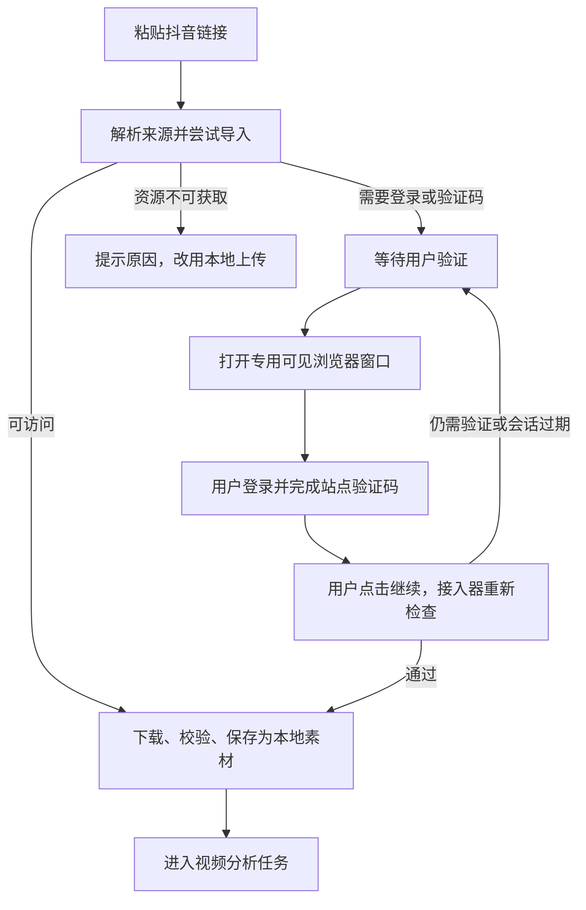

# 首版框架优化与后续扩展设计

日期：2026-10-28  
状态：架构与产品设计评审。当前仓库只有方案和五份技能脚本初稿，没有可运行的前后端；本文件不表示已完成页面、浏览器导入或视频链路开发。

## 1. 范围再次确认

第一版完成五个入口：图片生成、模特换装、场景复刻、视频生成、一键对标；配套技能 Markdown、模型参数配置、后台持久化任务、算力账本与 Windows 启动包。

后续功能只做设计预留，不提前安装大型依赖或展示无法执行的入口：

| 后续功能 | 第一版做什么 | 第一版不做什么 |
| --- | --- | --- |
| 抖音链接导入 | 素材保留来源、导入方式、原始名称与哈希；定义来源适配器接口 | 不做抓取、登录、验证码浏览器和下载器 |
| 爆款视频智能体 | 步骤依赖、确认点、结构化产物、可恢复任务和费用汇总 | 不做视频解析、人物替换、分镜生成和合成入口 |
| 视频提示词反推 | 模型分类与产物契约可扩展，保留提示词/参数/证据快照 | 不接通文本模型，不为普通生成额外调用大模型 |
| 提示词收藏与灵感库 | 持久保存最终提示词、变量值、技能修订和源任务关系 | 不显示收藏入口或灵感库页面，不引入旧海外灵感池 |

后续能力通过版本迁移添加表和处理器。第一版只实现当前实际使用的处理器，避免为了“可扩展”先建设庞大的插件市场或通用可编程平台。

## 2. 对现有方案的严格评审

本次是文档、脚本与架构评审；没有运行中的界面可做截图或性能实测。以下问题需进入第一版实现与验收，不能只列为“以后优化”。

| 发现的问题 | 决策 | 落地验证 |
| --- | --- | --- |
| 技能页面类型与模型类别容易混淆 | 技能分类仅 image/video/agent；模型类别单独维护 image/video，未来增加 ai/speech | agent 可包含不同类别步骤，不能把 agent 当成供应商模型类型 |
| 当前结果描述偏重图片/视频 | 定义统一产物引用，预留 JSON/Markdown/text 类型 | 加载历史时不依赖“每个任务都有图片 URL” |
| 五份 `.md` 尚无实际解析器 | 显式 Schema、版本、错误定位、发布快照 | 文件有效、页面能显示、执行器可用是三项不同检查 |
| 缺少完整参数边界时配置可能误执行 | 服务端与客户端共享 Zod 契约，校验交叉条件（语义完整性由用户确认，不宣称首版自动视觉识别） | 超数量、错误配对、重复 ID、未知变量与非法模型参数不可提交 |
| `.md` 内容不能证明商品细节真实 | 明确素材角色与原图真值，不宣称自动完美还原 | 图案、版型、人物、场景由样本人工评估 |
| 计划预览与消耗统计可能使用不同规则 | 计划哈希含输入/技能/模型/计费修订；提交事务重新校验 | 计划修订变化时更新预览，不静默改变调用范围；余额不足仅提醒 |
| 等待素材可能被理解为中断已提交任务 | 依赖等待与媒体执行分离，未提交项等待所选白底产物 | 关闭窗口后已提交媒体继续；打开时恢复等待原因和处理入口；首版无白底审核点 |
| 失败重试可能重做整个智能体 | 结果按步骤/尝试落库，下载与生成重试分开 | 单张失败只恢复该项，不重复白底图与算力结算 |
| 新增模型不能靠名称获得真实能力 | 同协议配置映射；新协议注册适配器 | 无合同映射的模型不可执行，不能自动出现无效控件 |
| UI 已有风格方向但没有可验收规则 | 固化组件、状态、桌面视口和关键操作路径 | 以截图、操作录像/记录和浏览器检查验收，不能只说“科技感” |
| Windows 发布不能只看 macOS 开发环境 | 编译、打包及原生依赖在 Windows 验证 | 实测 `run.bat`、中文路径、端口冲突、重启恢复 |

## 3. 第一版前后端框架

### 3.1 工程边界

建议采用一个仓库、清晰分包，不拆成多个必须分别部署的服务：

```text
apps/web/                  React + Vite 工作台
apps/server/               Fastify API、Worker 入口、启动监管
packages/contracts/        Zod Schema、类型、错误码与状态转换契约
packages/engine/           技能解析、计划编译、步骤调度、参数解析
packages/providers/        原系统媒体 API 适配逻辑
skills/                    五份技能提示词.md
scripts/                   开发、构建、Windows 打包与诊断
docs/                      方案、验收记录
data/                      运行数据，隔离于程序和源码
```

目录为拟议结构，当前不创建空壳模块冒充实现。具体可在开发时合并小包，但业务依赖方向必须清晰：Web 不导入数据库、密钥或供应商代码；API 与 Worker 共用同一套任务和账本服务。

Worker 可以单独进程运行，由同一启动器监管。数据库用 SQLite，本机素材用文件存储，不引入 Redis 或云数据库作为首版前置条件。

### 3.2 通用产物与步骤契约

持久化实体至少区分：创作记录、步骤、生成尝试、素材、结构化产物、快照与事件。

```ts
// 概念契约，开发时通过 Zod 落地。
type ArtifactKind = 'image' | 'video' | 'audio' | 'json' | 'markdown' | 'text'

type ArtifactRef = {
  id: string
  kind: ArtifactKind
  schemaId?: string
  sourceTaskId: string
  sourceStepId: string
  revision: number
}
```

第一版支持实际用到的图片/视频及提示词与计划快照；其他类型预留兼容的引用格式，后续再增加对应存储、校验和展示器。JSON 产物使用明确的 Schema 和版本，不把任意 JSON 原样塞给用户。

步骤处理器使用注册表按类型分派。首版实现媒体生成、已有素材引用及外部白底任务依赖解析；白底生成是独立操作，引用和依赖解析不额外调用模型。以后导入、解析、AI、合成是新增注册项，不通过在技能脚本里执行 Python 或 Shell 实现。

模型适配器和步骤处理器不同：前者管理供应商协议；后者管理本地运算及产物转换。相同的 AI 理解处理器可使用不同文本/视觉模型，不应为每个模型重新写一套智能体。

### 3.3 状态与持久化

运行任务使用已有排队、执行、提交、查询、成功、失败、待核实等语义。工作流另有“等待用户操作”，并保存结构化原因及继续条件，不以一条错误文本模拟。

```text
waiting-input:
  kind: review-artifact | supply-asset | authenticate-source
  relatedArtifactId?: ...
  resumeCheckpoint: ...
```

第一版白底独立操作，替换 item 可提前排队依赖所选白底任务；成功后自动继续，不设审核点。白底失败等待用户重做或主动换参考，未来其他确认点到相应功能上线再实现。等待不占生成工作槽，提交未知保留待核实用量，不重复发起生成；首版无冻结算力。用户继续时检查输入修订、产物有效性和剩余报价。

### 3.4 依赖及测试策略

API、任务、模型、素材、技能、账本分别有服务边界；路由仅负责鉴权/校验/调用服务/响应。业务事务不能分散在 React 点击处理器或多个随意 SQL 片段中。

首版即验证：技能解析与计划编译、模型参数映射、用量记录事务与幂等、Worker 租约/恢复、状态事件补取、素材落盘与去重、普通任务与智能体的浏览器路径。

使用供应商模拟器稳定复现超时、500、无任务编号、成功后下载失败、重复通知等情况。真实付费测试单独执行与统计，不把自动化单元测试接到付费生成接口。

## 4. 未来抖音链接与验证码怎么设计

### 4.1 获取视频是独立的“素材导入任务”

不把下载视频写进视频生成接口，也不把网站 Cookie 传给媒体生成模型。来源接入器负责识别、获取与保存，成功后输出一个普通本地视频素材 ID，后续与用户直接上传视频走相同分析路径。

输入优先顺序：本地上传始终可用；链接导入在站点接入器支持并验证后开放。页面清楚显示“链接已解析”“等待验证”“下载中”“素材已保存”，不能把读到封面当成已经拿到视频。

### 4.2 用户可见的验证流程



图片、滑块、短信等验证码由用户在站点原页面完成。不要建设自动识别/代答验证码服务、绕过登录的抓取链路或无限重试刷新。验证尚未通过是等待状态，不是生成失败，也不开始付费分析。

点击“已完成验证/继续”只是请求后端重新检查；必须实际拿到有效素材再推进，不能信任用户点击本身等于验证成功。

### 4.3 浏览器桥接与会话

当前系统是本地网页，没有桌面 WebView。后续可选使用受控的独立可见 Chromium/Chrome 窗口，由本机 BrowserBridge 接入；站点 iframe 经常受嵌入限制，不作为默认方案。

- 使用应用专用浏览器配置目录，用户主动登录；不读取日常浏览器的个人 Cookie 或密码。
- Session 与导入任务/来源站点绑定，可复用用户授权会话，但不保证长期有效；过期后重新验证。
- 本机浏览器连接仅对本应用开放，调试端口不得暴露给局域网；Cookie 不进入前端、提示词、日志、诊断导出或模型请求。
- 验证窗口关闭时保存导入任务为等待操作；重新打开从检查点继续。应用重启先恢复任务记录，再检查浏览器是否仍可连接，不将旧窗口 ID 当作有效会话。
- 站点要求验证或限流时退避，避免多个批次同时开许多验证窗口；导入等待有独立队列，不占媒体生成并发。

即使登录通过，视频也可能下架、仅部分可访问或无可用下载途径。应显示具体结果并保留本地上传入口，不承诺任意抖音链接都能成功获取。

### 4.4 落盘、缓存与来源

保存来源 URL、内容标识（能取得时）、导入时间、接入器版本、文件哈希、分辨率/时长及获取状态。导入按来源与内容去重，最终以文件哈希确认；来源链接与文件可能更新，不只按 URL 永久复用。

下载使用临时文件、断点/重新获取策略和完成校验。带时效的下载 URL 不作为长期素材地址；分析只引用已保存文件。过期链接只恢复导入，不触发媒体重新生成或重复分析。

链接导入器限制来源站点与允许的媒体跳转，校验重定向目标和实际内容，不成为任意 URL 代理。需要登录的凭据留在专用会话，不转发到无关域名。

原视频素材导入默认不收取模型算力，但保留耗时、流量与本地资源记录；若未来增加收费下载服务，必须单独声明并计费，不能混入生成点数。

## 5. 未来爆款视频智能体

建议将“复刻”定义为参考镜头表达、节奏与带货逻辑，适配用户商品；用户确实需要同场景替换时提供明确模式，不能对所有新品默认一比一换皮。

```text
本地上传 / 抖音导入 → 本地视频素材
  → 本地解析：元数据、代表关键帧、可选场景切片 JSON、语音候选
  → 视觉/文本模型理解：源片镜头脚本与证据
  → 结合用户商品：新版脚本与分段计划
  → 用户审查脚本与预计算力
  → 图片模型生成首帧（必要时生成并核验尾帧）
  → 试生成 1—2 段 → 确认后扩大视频生成
  → 配音/字幕/音乐处理 → 本地 FFmpeg 合成 → 历史成片
```

### 5.1 本地解析

`claude-real-video` 作为本地解析候选，通过适配层封装，承担已验证的抽帧/场景数据能力；语音转写由其实际支持的组件或独立 Whisper 兼容工具提供。接入前需核对版本、依赖、许可证、Windows 支持和实际输出，不能把计划中的整个解析链都算成它已经具备。

快速模式抽取代表帧和必要的变化点，不默认生成大量独立切片。精细模式需要对齐原时间轴或音频时再切片。场景切片数据与“必须生成同样数量镜头”分开。

无声、无台词或音频不清时分别记录；转写候选不是已确认逐字口播。区分画面文字 OCR、语音文本、视觉观察与模型创作假设。

### 5.2 模型理解与新品改编

GPT-6.1 Sol 可作为用户希望接入的模型显示名称；实际能否作为 API 调用、具体模型 ID 和输入能力以供应商/现有连接为准。应用中的模型名字不能自动当成 API 接口存在或有额度。

接入 ChatGPT/OpenAI 兼容或其他文本服务时，使用独立供应商适配器与后端凭证，不把网页版登录状态当 API 密钥。需要多模态理解时选择确实支持图像输入的模型；仅支持文本的模型只能处理已有转写/脚本，不能宣称看过视频。

源片理解输出包括整体风格、环境、出镜方式、节奏、运镜、光照、镜头时间与动作、画面文字、口播、背景音、转场、证据与不确定性。保留源片脚本与新品脚本为两个版本，不覆盖分析事实。

新品可以重设镜头数与时长，以商品实际用途和可展示动作重新编导。分析结果按视频哈希与解析/理解配置复用，换商品时不必重新分析原视频。普通图片/视频生成仍不默认调用这些步骤。

### 5.3 首帧、视频与合成职责

首帧图片使用 **TT Image 2.5 或其他已接入的图片模型**。Omni/GK 用于视频段生成，不把视频模型名称直接当成可生成精准首帧的图片端点。

“3–5 秒一段”是导演目标，不是任意接口都允许的参数。原系统 Omni Flash 预设 4/6/8/10 秒，可选择合法档位后规划；GK 预设虽有 1–15 秒范围，但代码标记合同未验证，不直接视为可用。首尾帧只在合同明确、字段映射且测试通过后开放。

默认先核对商品与人物首帧，试生成 1—2 段后扩大。生成长度和剪辑时长分别记录；不能依靠任意加速、裁剪使动作失真。镜头一致性、商品印花和材质仍需人工检查，不承诺“完美复刻”。

合成首选直接使用 FFmpeg，满足拼接、转码、字幕、混音与响度处理即可；确有复杂程序化编辑需求再增加 MoviePy/Python。每项本地命令由受控处理器构造参数，不执行模型返回的代码。

最终交付定义必须包含是否有字幕、配音、背景音乐及实际文件。原声仅在用户选择且适配新品内容时保留；改写台词后需要新配音。音频缺失不能静默交付成“完整带货视频”。

### 5.4 费用与恢复

扩展原有算力框架，分别报价文本/视觉理解、图片、视频、TTS，按步骤结算，智能体父记录仅汇总。文本模型未来可按固定次或 Token 计费；新增规则需独立设计输入/输出 Token、舍入及上限，不能把现有图片按次公式直接用于不确定 Token。

未来实际用量不确定的步骤需配置输出/调用范围，显示有依据的估算，缺失账单单列待核实。沿用首版统计提醒，不引入预占或硬预算；审查点后刷新后续估算。若另需硬预算，应作为独立需求重新确认。

本地导入、抽帧、渲染与模型生成分别计时。已完成原片分析、脚本、首帧和片段均落库，失败只恢复对应项；模型提交未知时不重新扣费调用。

## 6. 提示词反推作为独立未来技能

输入可为已保存视频、关键帧和语音/文字材料，输出结构化镜头脚本与可复制的整片/分段提示词，不自动调用图片和视频生成。

与爆款视频智能体复用源片分析和提示词产物。用户可以只反推、只修改脚本，或者明确选择继续生成。结果提供中文可读稿，是否需要英文执行稿由模型和用户设置决定，不默认增加一次翻译调用。

文本模型设置复用供应商、凭证、能力、参数和计费规则；上下文长度、图像输入、结构化输出等按模型能力校验，不能将任意兼容文本接口都标成视频理解模型。

## 7. 收藏提示词与未来灵感库

第一版保存每次执行的提示词与参数快照，供历史详情查看；收藏按钮及灵感库页面后续再做。未来灵感库服务国内创作，与已移除的海外灵感池没有自动迁移关系。

收藏对象建议包含标题、正文、分类、标签、封面素材引用、原任务、原技能修订、变量快照、创建时间。收藏时保存独立快照，原任务更新或模板改版不会改变已收藏内容。

使用收藏时创建新的草稿，检查所需素材和模型参数；不会自动重跑旧任务。缺少的素材引用要求补充，不能拿本机失效路径静默生成。编辑收藏也不会修改技能或历史任务，除非用户另行发布技能。

先做独立个人库、搜索、筛选和应用到草稿即可，不先建设复杂社区、推荐或外部同步。启用后通过功能开关注册入口，默认不占用第一版侧栏。

## 8. 第一版 UI 框架严格优化标准

### 8.1 组件和状态

React + TypeScript + Vite；shadcn/ui 统一基础组件，Tailwind CSS 使用语义主题变量。业务组件至少包括能力侧栏、素材输入、参数弹窗、任务批次卡、媒体预览、模型选择、算力摘要和任务抽屉。

UI 与路由按功能注册表生成，不在页面到处判断技能 ID。模型字段由 Schema 渲染，控件复用相同的错误、禁用、帮助信息与焦点规则。

业务状态由后端认定；React 本地状态只负责交互，TanStack Query 管理服务端快照，SSE 按游标更新。旧请求返回不可覆盖新修订，切换能力不清空其他能力草稿。

每个数据区域定义初次加载、刷新、空态、局部失败、离线和已有数据可读状态。刷新保留旧结果并标注更新中，不整页闪空；网络断线不将后台任务变成失败。

普通技能参数矩阵使用弹窗，配置技能提示词特有参数，并分区展示低频模型参数；常用模型、画幅、数量和视频时长留在底部大输入框周边。智能体使用完整流程，不挂载通用底部输入台。

普通技能后台接单成功后，将文字、素材选择、模型和参数恢复技能默认值，同时消费后端对应草稿；失败/受理未知保留输入，核实后再处理。结果流卡片使用统一基础高度，默认仅显示状态、当前步骤、产物缩略图、打包下载及每项提示词/再生成操作；批量按网格增行。细节见 [结果流与输入区交互规范](工作台结果流与输入区交互规范.md)。

### 8.2 媒体性能与桌面操作

一键对标采用左原图、中参数/参考缩图与提示词编辑入口、右结果的 item；列表分页或在数据量足够大时虚拟化，缩略图懒加载；不把多段原视频同时设为自动播放。预览弹窗打开时加载原媒体，关闭后暂停并释放临时 URL。

已上传素材展示缩略图、角色与状态，不显示文件名。普通输入区默认便利贴式叠放，悬浮/点击/键盘展开全部；大量素材在浮层滚动。上传单张、多张及视频权限由技能输入声明与模型已验证能力共同控制；粘贴/拖拽与文件选择走同一校验管线，失败定位到对应缩略项；不可用素材不进入报价。

桌面验证 1280、1440、1920 宽度及常见 Windows 缩放，确保底部输入台不遮挡最后一张结果卡，侧栏可滚动、主操作可见、参数弹窗不超出可用高度。不做手机适配。

### 8.3 视觉与交互

采用已确认的 AI 科技感与潮牌电商方向，延续主题基线；商品画面是视觉重点，任务区保持易读。统一字号层级、圆角、状态颜色和留白，不用持续闪烁或大量装饰动画代替真实进度。

键盘可操作上传按钮、模型选择、任务动作和弹窗；弹窗有标题、焦点限制及关闭后的焦点恢复。错误和状态不能只靠颜色。交互遵循已有 120/200/300ms 动效刻度，并支持减少动态效果。

### 8.4 实际验收记录

第一版开发后需进行一次严格浏览器与 Windows 流程验收，至少记录：

1. 五个技能入口、全部参数与空/加载/失败/已完成截图。
2. 单图、多图、逐图换装、一键对标及普通视频完整路径。
3. 刷新、关闭全部网页、多标签提交和后端重启的状态与结果。
4. 技能发布、模型新增/切换、非法参数、报价失效与余额不足。
5. 用量重复通知、下载失败恢复、提交未知及统计对账。
6. 长任务列表、媒体大图预览、拖拽粘贴、缩放与键盘交互。
7. Windows 解压启动、中文路径、端口占用、日志与依赖诊断。
8. 普通任务发送后全量初始化且刷新不恢复已消费草稿；失败不丢输入；智能体无通用底部输入区。
9. 单行任务卡各状态等高、批量网格增行、提示词完整复制、单项再生成、图片/视频预览与后台打包。

报告区分已通过、未通过、未测和需人工质量验收；发现问题修复后复验受影响路径。不用“构建成功”替代真实浏览器流程，也不用漂亮截图证明后台可靠。

## 9. 交付顺序

先落实首版共用框架与五个真实闭环，再考虑文本理解和提示词反推；视频导入/用户验证独立上线验证，之后组合爆款视频智能体。收藏与灵感库按运营需求再上线。

历史设置复用、再生成与保存恢复、批次轮转、磁盘及引用保护、完整备份与恢复核实作为首版要求，详见 [可靠性与运营效率补充](首版可靠性与运营效率补充.md)。文中的恢复与任务验收须同时覆盖这些故障场景。

第一版可扩展的标准是：后续功能能通过新的处理器、产物与页面注册接入，并继续使用同一套素材、任务、事件、规则快照与算力账本；不是第一版必须把后续功能全部实现一遍。
